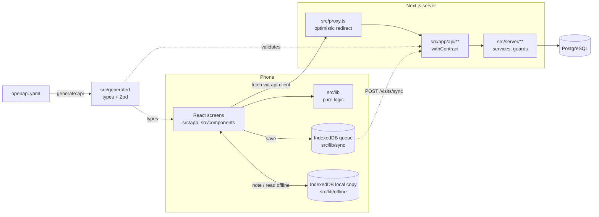

# Architecture

How the codebase is put together and why. Rules for working in it live in
[CLAUDE.md](../CLAUDE.md); the decision behind each piece lives in [tasks/](tasks/).

## Shape

One Next.js app serves both the UI and the API. PostgreSQL is the only store on the
server; on the device IndexedDB holds the visit write queue (#33) and, in a separate
database, the offline shell's local copy (#77).



## Layers

| Path                  | Holds                                        | Coverage | Notes                                                              |
| --------------------- | -------------------------------------------- | -------- | ------------------------------------------------------------------ |
| `openapi.yaml`        | The API contract                             | —        | Source of truth. Edited first, always.                             |
| `src/generated/`      | Types and Zod schemas from the contract      | excluded | Never hand-edited; CI regenerates and diffs.                       |
| `src/app/api/**`      | Route handlers, one file per path            | 100%     | Thin: guard, call service, return. Wrapped in `withContract`.      |
| `src/server/http/`    | `withContract`, `ApiError`s, route registry  | 100%     | Validates request _and_ response; maps errors to the envelope.     |
| `src/server/auth/`    | Auth.js config, guards, rate limit           | 100%     | `requireUser`, `requireRole`, `resolveMemberScope`.                |
| `src/server/<domain>` | Services, queries, serialisers per domain    | 100%     | sessions, blocks, visits (incl. sync), follow-ups, history, users. |
| `src/db/`             | Drizzle schema, client, test env, seed data  | 100%     | Constraints carry the invariants the API cannot race.              |
| `src/lib/`            | Framework-free helpers                       | 100%     | Where UI logic goes so it can be tested without rendering.         |
| `src/lib/sync/`       | Offline queue and sync engine                | 100%     | Pure functions over a `SyncQueue`; memory and `idb` adapters.      |
| `src/lib/offline/`    | Offline shell's local copy and shell state   | 100%     | Reducers, a `door-to-door-local` store, `shellState`.              |
| `src/components/`     | React components                             | 90%      | Client components; call the API with `fetch`.                      |
| `src/app/**` (pages)  | Routes                                       | 90%      | Admin pages call `requireAdminPage()` → 404 for members.           |
| `drizzle/`            | Generated migrations                         | excluded | From `drizzle-kit generate` only.                                  |
| `scripts/`            | `migrate.ts`, `seed.ts`, `generate-icons.ts` | excluded | Glue; the logic they call is in `src/db`.                          |
| `src/app/sw.ts`       | Service worker source (Serwist)              | —        | Served at `/serwist/sw.js` by `src/app/serwist/[path]/route.ts`.   |
| `e2e/`                | Playwright specs                             | —        | Pixel 5 and iPhone 13 profiles, standalone production build.       |

## Domain model

```
users ─┐
       ├─< visits >── households >── blocks
outing_sessions ─┘        │
       └─< session_blocks >┘
households ─< follow_ups (optional visit_id, set null on delete)
outing_sessions ─< session_participants (never removed)
outing_sessions ─< session_teams ─< session_team_members (unique per session+user)
visits >── session_teams (team_id, nullable, restrict); visits ─< visit_teammates
```

- **Household** = `(block_id, unit_number)`, unique. Name, contact, religion are
  latest-known and only ever updated with non-null values.
- **Visit** = one knock. `interest_level` and `description` never overwritten.
  `id` is a client-generated UUIDv7 with no database default.
- **Follow-up** attaches to the household, so it outlives the session. `dueDate` is
  a day (local midnight); overdue once that day has passed. Any member resolves or
  reopens (D-35-1, pending owner); text, due date and delete are author or admin. The
  first resolution sticks.
- **Session** (`outing_sessions`): `draft → active → ended`, reopenable. At most one
  `active`, by partial unique index.
- **Blocks** are shared across members and sessions, never locked.
- **Teams** (#74) are per outing. A visit is stamped once with its author's team and a
  `visit_teammates` snapshot (author excluded); names resolve at read time. Access is
  always CURRENT membership of `visits.team_id` (`src/server/teams/access.ts`,
  `canAmend`). Participants and team operations are in `src/server/teams/service.ts`
  and are online-only.

## Contested decisions

The issue-by-issue records in [tasks/](tasks/) are this project's ADRs (D-38-1). These are
the decisions that had a real alternative, summarised from those records; the record is
authoritative, and a change to any of them needs the owner.

### Households and visits, not flat visit records

- **Context.** A unit is knocked on many times, months apart, by different members. One
  flat row per knock would either repeat the person's details on every row or overwrite
  them, and would lose what an earlier visit learned.
- **Decision.** Split in two. A household is `(block_id, unit_number)`, unique, holding
  name, contact and religion as latest-known fields that are only ever updated with
  non-null values (D-07-1). A visit holds `interest_level` and `description`, which a
  later visit never overwrites (D-07-2). Follow-ups attach to the household, and
  `visit_id` is set null if the visit goes (D-07-5). Recording upserts the household by
  block and unit; the request never names a household id (D-20-1).
- **Why.** A later visit that learns nothing must not erase what an earlier one
  recorded; the interest trajectory over time is the product; losing a visit must not
  lose the promise made at the door.
- **Consequences.** Every write path has to merge identity rather than replace it
  (including teammates' amends through sync, D-74-22), and a visit can never be moved to
  another unit by an amend (D-74-32).

### JWT sessions (forced, not chosen)

- **Context.** Auth.js supports database sessions, which can be revoked on the server.
- **Decision.** JWT strategy (D-13-1). The Drizzle adapter's `auth_sessions` table
  exists only because the adapter requires it, and is unused (D-07-6).
- **Why.** The Credentials provider (email and password, #15) cannot use database
  sessions (R-2).
- **Consequences.** A token cannot be revoked and its claims are frozen at sign-in, so
  role and deactivation are read from the database on every API request and admin page;
  the token's claims are UI hints only (D-83-1, D-83-3). Deactivation is a
  `403 account_deactivated` on any operation (D-10-4, D-83-4).

### One active session app-wide

- **Context.** Admins run outings; members record into whichever is running.
- **Decision.** At most one `outing_sessions` row has `status = 'active'`, enforced by a
  partial unique index (D-07-4). A second start is `409 session_already_active`, decided
  by the database with no pre-check (D-17-2).
- **Why.** Two concurrent starts are a race the API cannot close on its own.
- **Consequences.** Members never choose an outing, only a block in the running one.
  Queued visits for an ended outing are held, not dropped, until it is reopened
  (D-21-4). The E2E suite runs on one worker because parallel specs would fight over the
  one active outing (D-37-4).

### Serwist, not next-pwa

- **Context.** The app needs a service worker for installability and an offline
  fallback.
- **Decision.** Serwist (D-32-1), now through `@serwist/turbopack`, with the worker built
  by a route handler at `/serwist/sw.js` (D-32-2, superseding D-32-1's `@serwist/next`).
- **Why.** `next-pwa` is unmaintained and Serwist is its maintained successor, the option
  the Next.js PWA guide points to (R-1). `@serwist/next` is a webpack plugin, and Next 16
  builds with Turbopack by default (R-17).
- **Consequences.** The worker is disabled outside production builds and updates are
  prompted, never forced (D-32-6, D-32-14); what it may cache is deliberately narrow
  (D-32-3, D-32-4).

## Request path

1. `src/proxy.ts` redirects page requests with no session to `/sign-in` and returns
   `401` for API requests. Node runtime (Next 16), so it can read the config file; it uses `buildBaseAuthConfig` (`src/server/auth/base-config.ts`, no adapter).
   It is an affordance, not a guard. The PWA files (`/serwist/*`, manifest, `/offline`)
   return before `auth()` runs (D-32-19).
2. The route handler is wrapped in `withContract(operation, handler)`: path, query
   (schema-driven coercion) and body are parsed with generated Zod; PATCH bodies go
   through `requireChanges`.
3. The handler gets its session from `currentSession` (`src/server/auth/session.ts`),
   which reads the user's role and deactivation from the database on every request (one
   primary-key lookup, no cache), then calls the pure `requireUser` / `requireRole`.
   Missing user is `401`, deactivated `403 account_deactivated`. A lookup failure is a
   `500`, never allowed.
4. The service does the work. Sync and `POST /visits` also run the clock rules
   (`src/server/visits/clock-rules.ts`) before any write. Constraint violations are recognised by name through
   the cause chain (`isConstraintViolation`) and turned into specific `409`s.
5. `withContract` parses the response; anything not in the contract fails in dev/test
   and is a logged `500` in production. Only the parsed value is sent.

An unexpected error (not an `ApiError`) becomes a generic `500 internal_error`.
`withContract` logs it as one line, `<operationId> failed: <summary>`, built by
`summarizeError` (`src/server/logging/error-log.ts`): name, code and a redacted first
line, never the cause chain or parameters. The log is throttled to one line per operation
per 5 s burst. The sync catch uses the same helpers.

## Configuration

- Settings are a YAML file read at runtime (`CONFIG_PATH`, default `./config.yaml`).
  `config.example.yaml` and `config.docker.yaml` are committed; `config.yaml` is not.
  Pure parsing and validation is `src/lib/config.ts`; file access and caching is
  `src/server/config.ts`.
- Secrets never go in the file: database user/password, `AUTH_SECRET`,
  `AUTH_GOOGLE_SECRET` are env vars with optional `_FILE` variants. `database.url` with
  credentials is refused.
- Loading is lazy (config, rate limiter, proxy, db client), so `next build` needs neither
  file nor database. `src/instrumentation.ts` validates at start and exits 1 on bad config.
- Tests use `TEST_DATABASE_URL`, the one place a full URL is allowed.

## Auth

Auth.js v5, JWT strategy (forced: the Credentials provider cannot use database
sessions). The token carries identity; its role and deactivation claims are UI hints and
are never used for authorization, which reads the database per request (also for admin
pages, with `admin/layout.tsx` as a structural guard). Credentials use argon2id
(`@node-rs/argon2`) with a decoy hash for unknown emails and a per-email rate limit
on failed attempts (a success clears it; a spent budget refuses even the right password).
Google SSO (#14) is not built.

## Client

- Screens fetch through `src/lib/api-client.ts`, typed by `types.gen.ts`.
- `useRole()` is UI affordance only. Its role comes from the latest `GET /users/me`
  (`loadCurrentUser()`) when that matches the token's user, else from the token.
- `apiFetch` reports any `401` or `403 account_deactivated` to `src/lib/account-state.ts`
  and still throws. `AccountGate` (in `AppShell`) then shows `AuthFailureScreen`, a
  blocking `useModal` (`onClose: null`) that makes the app `inert`; its only action signs out. The gate also reads `/users/me` once
  per document load.
- Overlay layers: sync status bar `z-20` (sticky), banners `z-30`, bottom nav `z-40`,
  sheets `z-50`, confirm dialogs `z-60`, account screen `z-70`. Guarded by `overlay-layers.test.ts`.
- Every sheet and `ConfirmDialog` is a modal through `useModal` (`src/lib/use-modal.ts`):
  focus in, Tab trapped, Escape closes the top layer only, page behind `inert` and
  unscrollable, focus back to the trigger (D-90-1 to D-90-9). A blocking modal stays on
  top of the stack, and siblings mounted later go inert too (D-85-12, D-85-14).
- The bottom nav does not render on public routes (its prefetches poisoned the
  router cache before sign-in) nor on the offline shell.
- Active-session screen: "Join this outing" (shown until the caller is in the server's
  participants list) and a "Your team" card (`outing-team.tsx`, `team-sheet.tsx`, texts in
  `src/lib/team-ui.ts`). Online-only: controls disable offline and nothing is queued or
  stored. The card refreshes with the screen's 30s poll and Refresh.
- Records show who made them through `VisitByline` (`src/lib/team-label.ts`): the author
  then the snapshot teammates with current names, plus a "Team:" chip (not on unit rows).
  Display-only; Amend affordance uses team ids the server vouched for
  (`GET /sessions/{id}/teams` or `includeTeam` results), see `src/lib/amend.ts`.
- Follow-ups: logic in `src/lib/follow-ups.ts`; `HouseholdHistoryPanel` (unit screen and
  recording form) pins outstanding notes above a visits-and-resolved-notes timeline.
  `/follow-ups` lists outstanding notes (`?view=mine`); admins get an overdue card on
  `/admin/sessions`. Online-only, re-read from the server after each change.
- `/history` and `/history/[id]` have a Me / My team toggle held in `?view=team`
  (`src/lib/team-view.ts`); the team view reads `/history/mine?includeTeam=true`.
- The admin outing detail has a team panel (`admin-teams.tsx`, `admin-team-sheet.tsx`),
  online-only and re-read on the detail screen's 30s poll.
- User pickers load every page of `GET /users` through `loadAllUsers()` (`src/lib/users.ts`).
- Native selects carry `h-12`: iOS WebKit ignores `min-height` on a select.
- Account screen (`/account`): reads the name from `GET /users/me`, renames through
  `PATCH /users/me`, then calls the JWT `update` trigger, which accepts only a valid
  display name. The token name is display-only; handlers read the database.
- Sign-out (`src/lib/sign-out.ts`): clears the block cache and the local copy (never the queue), warns
  on the member's unsent records (`hasUnsyncedItems(ownerId)`, D-33-15),
  `signOut({ redirect: false })`, then a full navigation to `/sign-in` (or a given
  destination, e.g. `/sign-in?reason=signed-out`). A refusal
  (Auth.js returns an `error` URL with 200) throws instead, and Account shows "Could not
  sign out".
- The proxy sets `Cache-Control: no-store` on signed-in page responses (not API), so Back
  after sign-out revalidates instead of restoring the page from bfcache.

## PWA and service worker

- `src/app/manifest.ts` and icons (`npm run icons` from `public/icon.svg`) make the
  app installable. The worker (`src/app/sw.ts`, `@serwist/turbopack`) is served at
  `/serwist/sw.js` and is disabled outside production builds. Manifest, `/serwist/*`
  and `/offline` are public to the proxy, which returns before `auth()` for them so a
  cookieless fetch never mints a CSRF cookie (D-32-19).
- Precache: static assets, icons and `/offline`; never authenticated HTML.
  Navigations are network-only with an `/offline` fallback. API is network-only except
  `GET /api/blocks` (stale-while-revalidate, own cache, 24h / 20 entries).
- The worker never touches IndexedDB. Updates are prompted and defer while the
  signed-in member's records are queued or failed (`hasRecordsToSend`, D-33-14); a
  page is controlled from its second load.
- `PwaProvider` registers the worker; `InstallPrompt` and `UpdatePrompt` are fixed
  banners at `z-30` that reserve space via `--banner-top` / `--banner-bottom`.
- Sign-in and sign-out clear the cached block list (sign-out: D-74-9) and the local
  copy (D-77-6).

## Offline

`POST /visits/sync` is idempotent on the client id, resolves conflicts last-write-wins
on `updatedAt`, reports per item (`applied`, `unchanged`, `stale`, rejected), and is rate
limited. Clock rules (#76) apply to it and to `POST /visits`: a batch whose `sentAt` is
off from the server by more than `sync.clockSkewToleranceSeconds` is refused `422
clock_skew`; items stamped in the future or before their outing are rejected
`clock_skew` while siblings apply.

**Queue (#33).** The recording form writes the visit to IndexedDB (`door-to-door`,
store `visits`, index `by-owner`) and moves on; it posts directly only when the queue
cannot be written. A visit is queued only with its outing's id (D-33-25). Each record carries its owner and a state: `queued`, `failed`,
`held`, `quarantined` or `synced`. Sending is in memory only. Nothing unsent is ever
deleted; sent records are purged after 24 h.

```
save ─► IndexedDB ─► controller (trigger) ─► Web Lock ─► GET /api/auth/session
                                                    │   (owner still signed in?)
                                                    ▼
                    flushOnce: owner's due records, oldest first, ≤100 (1 if isolated)
                                                    ▼
                    POST /visits/sync via apiFetch (fresh sentAt, 20 s timeout)
                                                    ▼
                    classify per item / whole batch ─► write back ─► BroadcastChannel
```

- `src/lib/sync/`: `enqueue` builds the item, `engine` sends a run, `classify` decides
  each outcome, `backoff` times retries, `controller` owns triggers, the lock and the
  timer. `idb-queue` and `memory-queue` implement `SyncQueue`; `record` validates every
  read, salvaging a record whose knock and owner are intact (D-34-8). `signed-in`
  checks the cookie's member before each batch. After a run storage fails, the
  controller waits 5 s doubling to 5 min before its timer fires again (D-34-6).
- Triggers: app start, each save, `online`, focus and visibility, the backoff timer,
  Retry. No Background Sync.
- `SyncProvider` (in `AppShell`) runs one controller for the signed-in member;
  `SyncStatusBar` and `SyncQueueSheet` show and retry it, and the unit list overlays
  unsent records (`unit-overlay.ts`).
- Outcomes are D-33-16 (per item) and D-33-17 (whole batch); the cap and isolation are
  D-33-26, D-33-6 and D-33-27 (a whole-request failure is never charged to a record).

**Offline shell (#77).** A navigation that fails gets the precached, static `/offline`
at the address that failed; `OfflineShell` then reads the local copy at runtime.

```
online:  outing / block screen ─► useLocalCopyWriter ─► door-to-door-local (copy)
offline: SW fallback /offline ─► OfflineShell ─► loadLocalCopy, usableCopy (≤ 12 h)
           ─► "Continue as <name>" ─► shellState.continueAs ─► SyncProvider owner
           ─► BlockViews (in-page, not amendable) ─► queue as usual
```

- The copy (`src/lib/offline/`) holds the member, the outing and each opened block's
  `HouseholdSummary[]`, validated with the generated Zod on read (D-77-3). It is cleared
  on sign-in, sign-out and by `LocalCopyKeeper` on a member mismatch; never the queue
  (D-77-2, D-77-6).
- While the shell is shown, `shellState` (not the path or session) decides the queue
  owner, the sync bar and the hidden nav (D-77-10, D-77-12). Sends still go through
  `sendAs`, so the cookie must name the owner.
- The queue flushes on its own triggers; a reconnect row offers Continue (a full
  `goTo`) once the server answers (D-77-11). `ReloadWhenOnline` runs only when there is
  no copy or before "Continue as".

**Sync write path.** Each item runs in one transaction: `INSERT ... ON CONFLICT DO
NOTHING RETURNING` (a row back means newly created, the only trigger for the teammate
snapshot and auto-join), otherwise `SELECT ... FOR UPDATE`, re-judge under the lock
(`canAmend`, newer `updatedAt`, same household and outing), then a narrow `UPDATE` of
interest, description and `updatedAt`. Non-`ApiError` failures are `rejected` with
`internal_error` (retryable). The request path above is unchanged; the new endpoints
(`/sessions/{id}/join`, `/participants`, `/teams`, `/teams/{id}/members`) are ordinary
`withContract` handlers.

**Limit: pairs and the queue.** The queue lives in one phone's IndexedDB, scoped to the
member who saved each record (D-33-1). Teammates (#74)
see and edit each other's records only once they have synced; unsynced records are
visible on the phone that made them and nowhere else, because two phones with no
reception cannot exchange data. The sync endpoint's rule that a member cannot overwrite
another member's visit (D-21-5) has a team exception (D-74-22), not a way around the queue.

## Testing

| Layer       | Tool                             | Runs against                                                           |
| ----------- | -------------------------------- | ---------------------------------------------------------------------- |
| unit        | Vitest (`*.test.ts`)             | node                                                                   |
| integration | Vitest (`*.integration.test.ts`) | real PostgreSQL (`db-test`, 5433)                                      |
| components  | Vitest (`*.test.tsx`)            | jsdom + Testing Library                                                |
| e2e         | Playwright (`e2e/`)              | standalone production build, Pixel 5 (Chromium) and iPhone 13 (WebKit) |

## Runtime

- **Dev:** `docker compose up` → `db`, one-shot `migrate` (migrate + seed), `web`.
- **Prod:** multi-stage `Dockerfile`, `output: "standalone"`, served by
  `node .next/standalone/server.js`.
- **Database pool:** one `pg` pool per process, cached on a `Symbol.for` global so
  Next's separate module graphs share it; changing `database.url` needs a restart. Every
  pool (app, scripts, test helper, E2E setup) gets `attachPoolErrorHandler`
  (`src/db/pool-errors.ts`). A dropped connection is logged once per burst and replaced
  on the next query. The query in flight rejects, so the request is a `500` and never
  crashes the process.
- **CI:** static checks (lint, types, format, spec lint, codegen and migration drift),
  tests with coverage against Postgres, production build, E2E.
