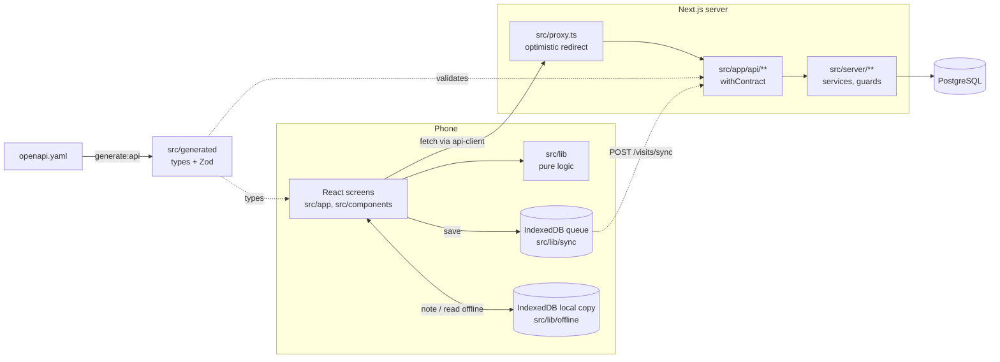

# Architecture

How the codebase is put together and why. Rules for working in it live in
[CLAUDE.md](../CLAUDE.md); the decision behind each piece lives in [tasks/](tasks/).

## Shape

One Next.js app serves both the UI and the API. PostgreSQL is the only store on the
server; on the device IndexedDB holds the visit write queue (#33) and, in a separate
database, the offline shell's local copy (#77).



## Layers

| Path                  | Holds                                                           | Coverage | Notes                                                                                 |
| --------------------- | --------------------------------------------------------------- | -------- | ------------------------------------------------------------------------------------- |
| `openapi.yaml`        | The API contract                                                | —        | Source of truth. Edited first, always.                                                |
| `src/generated/`      | Types and Zod schemas from the contract                         | excluded | Never hand-edited; CI regenerates and diffs.                                          |
| `src/app/api/**`      | Route handlers, one file per path                               | 100%     | Thin: guard, call service, return. Wrapped in `withContract`.                         |
| `src/server/http/`    | `withContract`, `ApiError`s, same-origin check, route registry  | 100%     | Validates request _and_ response; body caps; the error envelope; security headers.    |
| `src/server/auth/`    | Auth.js config, sign-ins and sign-out, headers, guards, limits  | 100%     | `requireUser`, `requireRole`, `resolveMemberScope`.                                   |
| `src/auth/`           | Auth.js entrypoint (`@/auth`); Google sign-in (`google.ts`)     | 100%     | Server-only (D-14-18); `@/auth` only in `session.ts` and the auth route (D-83-12).    |
| `src/server/<domain>` | Services, queries, serialisers per domain                       | 100%     | sessions, blocks, visits (incl. sync), follow-ups, history, users, teams, integrity.  |
| `src/db/`             | Drizzle schema, client, test env, seed data and its guard       | 100%     | Constraints carry the invariants the API cannot race.                                 |
| `src/db/stage-seed*`  | The stage stack's year of records and its guards                | 100%     | Never the demo seed; refuses all but the stack's own empty database (D-244-16).       |
| `src/server/stage/`   | The stage check: HTTP client, percentiles, toxiproxy            | 100%     | Tooling for `npm run stage:perf`; nothing in the app imports it (D-244-27).           |
| `src/lib/`            | Framework-free helpers, one folder per domain                   | 100%     | Where UI logic goes so it can be tested without rendering (D-115-1).                  |
| `src/lib/sync/`       | Offline queue and sync engine                                   | 100%     | Pure functions over a `SyncQueue`; memory and `idb` adapters.                         |
| `src/lib/offline/`    | Offline shell's local copy and shell state                      | 100%     | Reducers, a `door-to-door-local` store, `shellState`.                                 |
| `src/components/`     | React components, one folder per domain; shared pieces in `ui/` | 90%      | Client components; call the API with `fetch` (D-115-1).                               |
| `src/app/**` (pages)  | Routes                                                          | 90%      | Admin pages call `requireAdminPage()`: 404 for members, sign-in with no live sign-in. |
| `drizzle/`            | Generated migrations and their checksums                        | excluded | From `npm run db:generate` only, which appends `checksums.sha256` (D-131-9).          |
| `scripts/`            | migrate, seed, create-admin, check-blank-text, icons, stage-*   | excluded | Glue over `src/db` and `src/server`; `check-standalone.ts` runs as npm's `postbuild`. |
| `src/app/sw.ts`       | Service worker source (Serwist)                                 | —        | Served at `/serwist/sw.js` by `src/app/serwist/[path]/route.ts`.                      |
| `e2e/`                | Playwright specs                                                | —        | Pixel 5 and iPhone 13 profiles, standalone production build.                          |
| `test/`               | Vitest setup, global setup and shared test helpers              | —        | Migrates the test database and makes the run's config folder (D-109-1).               |

## Domain model

```
users ─┐
       ├─< visits >── households >── blocks
outing_sessions ─┘        │
       └─< session_blocks >┘
outing_sessions ─< session_households >── households (a follow-up session's picks)
households ─< follow_ups (optional visit_id and done_visit_id, set null on delete; status; soft delete)
outing_sessions ─< session_participants (never removed)
outing_sessions ─< session_teams ─< session_team_members (unique per session+user)
visits >── session_teams (team_id, nullable, restrict); visits ─< visit_teammates
users ─< sign_ins (one per device signed in; cascade on delete)
```

- **Household** = `(block_id, unit_number)`, unique. Name, contact, religion are
  latest-known and only ever updated with non-null values; a name or contact of only
  spaces is not learnt either (D-119-7).
- A unit number, note, block name or street is never blank: the contract, the service
  (`requireText`) and a `CHECK` each refuse it (D-119-1, D-119-3, D-119-4).
  `npm run db:check-blank` lists rows stored blank before #119, and changes nothing
  (D-119-9).
- **Visit** = one knock. `interest_level` and `description` never overwritten.
  `id` is a client-generated UUIDv7 with no database default.
- **Follow-up** attaches to the household, so it outlives the session. It is `listed`
  (on the follow-up list, which only an admin decides) or `suggested` (a member's
  request, one pending per household by partial unique index). Removal is soft and
  always has a reason: the row keeps who removed it, when and why, and leaves every
  list, count and check (D-117-4, D-117-33).
  `dueDate` is a day (local midnight); overdue once that day has passed. Who may change
  a note is D-117-12; the first resolution sticks.
- **Session** (`outing_sessions`): `draft → active → ended`, reopenable. At most one
  `active`, by partial unique index, whatever its `kind`: `regular` (door-to-door) or
  `follow_up`, fixed at creation. A follow-up session has households an admin picked
  (`session_households`, at least one) and its blocks are exactly theirs, kept in step
  by `src/server/sessions/households.ts`; nobody attaches them by hand (D-117-36 to
  D-117-38). Its list is computed, never stored: picks with a listed, live note
  outstanding, or resolved since both it started and the household was picked
  (`onRevisitList`, `src/server/follow-ups/list-rule.ts`, D-117-55). In it a member
  anyone records at any unit in its blocks (D-272-2); the list (D-117-40) decides only
  the marking and a member's note changes. A new
  visit at a household on the list marks its owed listed notes done in the same
  transaction, and `done_visit_id` keeps which visit did (D-117-65, D-117-67). Removing a
  note never changes picks (D-117-41).
- **Blocks** are shared across members and sessions, never locked.
- **Sign-in** (`sign_ins`): one row per device or browser signed in, named by the session
  token's `signInId` claim. Deleting it ends that sign-in (D-125-2). At most 50 per
  account, and expired after 30 days plus 15 minutes unused (D-125-7, D-125-8).
- **Approval** (`users.approval`, #249): `approved`, which everyone an admin adds is, or
  `pending` (a first Google sign-in) or `blocked` (rejected, until unblocked). A check
  keeps an unapproved account a member and never deactivated (D-249-1). Only approved
  people are on the team, its pickers and its counts (D-249-7, D-249-8).
- **Teams** (#74) are per session. A visit is stamped once with its author's team and a
  `visit_teammates` snapshot (author excluded); names resolve at read time. Access is
  always CURRENT membership of `visits.team_id` (`src/server/teams/access.ts`,
  `canAmend`). Participants and team operations are in `src/server/teams/service.ts`
  and are online-only.

## Contested decisions

The issue-by-issue records in [tasks/](tasks/) are this project's ADRs (D-38-1). These are
the decisions that had a real alternative, summarised from those records; the record is
authoritative, and a change to any of them needs the owner.

### Households and visits, not flat visit records

- **Context.** A unit is knocked on many times, months apart, by different members. One
  flat row per knock would either repeat the person's details on every row or overwrite
  them, and would lose what an earlier visit learned.
- **Decision.** Split in two. A household is `(block_id, unit_number)`, unique, holding
  name, contact and religion as latest-known fields that are only ever updated with
  non-null values (D-07-1). A visit holds `interest_level` and `description`, which a
  later visit never overwrites (D-07-2). Follow-ups attach to the household, and
  `visit_id` is set null if the visit goes (D-07-5). Recording upserts the household by
  block and unit; the request never names a household id (D-20-1).
- **Why.** A later visit that learns nothing must not erase what an earlier one
  recorded; the interest trajectory over time is the product; losing a visit must not
  lose the promise made at the door.
- **Consequences.** Every write path has to merge identity rather than replace it
  (including teammates' amends through sync, D-74-22), and a visit can never be moved to
  another unit by an amend (D-74-32).

### JWT sessions (forced, not chosen)

- **Context.** Auth.js supports database sessions, which can be revoked on the server.
- **Decision.** JWT strategy (D-13-1). The Drizzle adapter's `auth_sessions` table
  exists only because the adapter requires it, and is unused (D-07-6).
- **Why.** The Credentials provider (email and password, #15) cannot use database
  sessions (R-2).
- **Consequences.** A token's claims are frozen at sign-in, so role and deactivation are
  read from the database on every API request and admin page; the token's claims are UI
  hints only (D-83-1, D-83-3). Deactivation is a `403 account_deactivated` on any
  operation (D-10-4, D-83-4), and an unapproved account `403 account_pending` or
  `account_blocked` (D-249-4). A JWT cannot be taken back on its own, so each one names a
  `sign_ins` row that the same lookup checks: deleting the row ends that sign-in before
  its token expires (D-125-2, D-125-3).

### One active session app-wide

- **Context.** Admins run sessions; members record into whichever is running.
- **Decision.** At most one `outing_sessions` row has `status = 'active'`, of either
  kind, enforced by a partial unique index (D-07-4). A second start is
  `409 session_already_active`, decided by the database with no pre-check (D-17-2).
- **Why.** Two concurrent starts are a race the API cannot close on its own.
- **Consequences.** Members never choose a session, only a block in the running one.
  Queued visits for an ended session are held, not dropped, until it is reopened
  (D-21-4). The E2E suite runs on one worker because parallel specs would fight over the
  one active session (D-37-4).

### Admins decide the follow-up list

- **Context.** Any member could write, resolve and reopen a note at any time (D-35-1),
  so the list of doors to revisit was whatever anyone had written.
- **Decision (owner).** Only an admin puts a household on the list; a member's note is a
  suggestion an admin adds or dismisses. A follow-up session goes back to households an
  admin picks from that list, at least one, and its blocks follow them. Members change
  listed notes only during a follow-up session that picked them; anyone records at any
  unit in its blocks, and only a visit on the list marks notes (D-272-2). Every removal is soft and needs a reason (D-117-3, D-117-4, D-117-12, D-117-33, D-117-36 to D-117-38).
- **Why.** A follow-up session needs a list someone chose, a member must never open an
  empty block, and a removal must be explainable to the note's author.
- **Consequences.** One rule decides the list, the marking and a member's
  right to change a note, so they cannot disagree (D-117-40, D-272-4). An off-list visit
  is a one-off that marks nothing (D-272-3); a record held before #272 lands on its next
  probe (D-272-6). Picks and
  visit writes meet on the session row in one lock order (D-117-45). A visit at a door on
  the list closes its notes on the server, so a queued one does too when it lands
  (D-117-73). Removed notes stay in the database for good.

### Serwist, not next-pwa

- **Context.** The app needs a service worker for installability and an offline
  fallback.
- **Decision.** Serwist (D-32-1), now through `@serwist/turbopack`, with the worker built
  by a route handler at `/serwist/sw.js` (D-32-2, superseding D-32-1's `@serwist/next`).
- **Why.** `next-pwa` is unmaintained and Serwist is its maintained successor, the option
  the Next.js PWA guide points to (R-1). `@serwist/next` is a webpack plugin, and Next 16
  builds with Turbopack by default (R-17).
- **Consequences.** The worker is disabled outside production builds and updates are
  prompted, never forced (D-32-6, D-32-14); what it may cache is deliberately narrow
  (D-32-3, D-32-4).

## Request path

1. `src/proxy.ts` redirects page requests with no session to `/sign-in`, the page as
   `callbackUrl` less any `q` (D-163-8), and returns `401` for API requests. Node runtime (Next 16), so it can read the config file; it uses `buildBaseAuthConfig` (`src/server/auth/base-config.ts`, no adapter).
   It is an affordance, not a guard. Under `next dev` only, it first answers `403` to a
   `Host` that is not `localhost`, `127.0.0.1` or `[::1]`, a network guard against DNS
   rebinding that a production build drops (D-124-8). The PWA files (`/serwist/*`,
   manifest, `/offline`) return before `auth()` runs (D-32-19). On every path it matches
   (all but static files), Next buffers at most 2 MiB of the body and hands the handler
   that much: a longer body is cut short, not refused
   (`experimental.proxyClientMaxBodySize`, set from `PROXY_BODY_LIMIT_BYTES`, D-120-7).
   On Auth.js's routes that cut is the only bound; the contract's caps in step 2 sit at
   least 512 KiB below it, so a cut body still gets `413` there (D-126-6).
2. The route handler is wrapped in `withContract(operation, handler)`. First, a write
   (not `GET`, `HEAD` or `OPTIONS`) another origin sent is `403 forbidden`: decided by
   `Sec-Fetch-Site`, else by `Origin` against `X-Forwarded-Host` or `Host`
   (`src/server/http/same-origin.ts`, D-121-1 to D-121-5). Then path and query are
   parsed (schema-driven coercion), and `offset` above 10,000 is `400` (D-126-9). A body
   over its cap is `413 content_too_large`: 256 KiB, or 1.5 MiB for sync
   (`src/server/http/body-limit.ts`). It is refused on `Content-Length` before reading,
   or once the stream passes the cap (D-126-4, D-126-5). Then a body that is not
   `application/json` is `415` (D-121-6), and the body is parsed with generated Zod;
   PATCH bodies go through `requireChanges`. This runs before any role check. Every
   request array but `CreateTeamRequest.memberIds` has a `maxItems`, so an oversized one
   is refused on its length before any item is parsed (D-118-5, R-91). `memberIds` is
   uncapped (D-74-15, D-118-6); the 256 KiB cap bounds it at about 6,700 ids (D-126-7).
3. The handler gets its session from `currentSession` (`src/server/auth/session.ts`),
   which reads the user's role and deactivation, and the token's sign-in, from the
   database on every request (one query, nothing kept across requests; an admin page's
   layout and page share it through React `cache()`, D-252-4), then calls the pure
   `requireUser` / `requireRole`. A missing user or an ended sign-in is `401`; a deactivated account is
   `403 account_deactivated`, whatever its sign-in. One not approved is
   `403 account_pending` or `403 account_blocked`, failing closed; only `GET` and
   `PATCH /users/me` take it, through `requireOwnAccount` (D-249-4, D-249-5). "Last
   used" is written at most every 15 minutes (D-125-3, D-125-6). A lookup failure is a `500`, never allowed. Sync and `POST /visits` then each charge the caller's own
   budget, 30 a minute, and are `429 rate_limited` once it is spent
   (`src/server/visits/rate-limits.ts`, D-21-6, D-126-8).
4. The service does the work. Reads that need nothing from one another go out together,
   never on a transaction's client (D-252-1). Text that must say something (a unit
   number, note, block name or street) is refused blank before anything is read
   (D-119-3). Sync and
   `POST /visits` also run the clock rules
   (`src/server/visits/clock-rules.ts`) before any write. Inside the write's
   transaction `POST /visits` first locks its author's user row (`FOR SHARE`) and
   refuses a deactivated author (`409 conflict`, D-132-4, D-132-5); sync's author is
   the caller, checked in step 3. Then both lock the session row (`FOR KEY SHARE`) and
   judge the session and the block (D-272-5). Sync does this once per
   run of new records and judges every record of the run before writing any
   (`refuseUnderLock`, D-251-3; see Offline). A new visit on the list then marks the
   household's owed notes done, last (`markDoneByVisit`, D-117-69), and the answer is a
   `RecordedVisit` naming them. An amend (`PATCH /visits/{id}`, or a
   sync item for a stored visit) is one transaction that locks the session
   `FOR KEY SHARE`, the household, the visit `FOR NO KEY UPDATE` and the team membership
   `FOR KEY SHARE`, and judges `canAmend` on those rows (D-123-1 to D-123-3). Changing a
   follow-up session's households, detaching a block and transitions lock the session
   row `FOR UPDATE` (D-117-45, D-123-4). Forming a team and adding to one first lock
   the placed users' rows `FOR SHARE` in id order (ids lower-cased and de-duplicated),
   then the session row `FOR KEY SHARE` (an add with its team's row, then a member
   caller's membership), and judge the session, the team and the people on those rows:
   a missing or unapproved person is `404`, a deactivated one `409 conflict`. Teams and joins are
   checked in the same transaction, and members inserted in id order (D-158-2, D-158-3,
   D-180-1 to D-180-4). `PATCH /users/{id}` locks the target and every
   active admin `FOR NO KEY UPDATE` in id order, and refuses a change that would leave
   no active admin (`409 conflict`, D-132-1, D-132-2). A deactivation then deletes the
   user's sign-ins; a new sign-in takes the user `FOR SHARE` before writing its row, so
   none outlives a deactivation (D-125-10, D-125-11).
   Constraint violations are recognised by name through
   the cause chain (`isConstraintViolation`) and turned into specific `409`s.
5. `withContract` parses the response; anything not in the contract fails in dev/test
   and is a logged `500` in production. Only the parsed value is sent.

An unexpected error (not an `ApiError`) becomes a generic `500 internal_error`.
`withContract` logs it as one line, `<operationId> failed: <summary>`, built by
`summarizeError` (`src/server/logging/error-log.ts`): name, code and a redacted first
line, never the cause chain or parameters. The first line ends at any line break, and
control characters are replaced (D-128-7). The log is throttled to one line per operation
per 5 s burst. The sync catch uses the same helpers.

## Response headers

- `next.config.ts` `headers()` applies one build-time list
  (`src/server/http/security-headers.ts`) to `/(.*)`. It holds a Report-Only CSP, HSTS
  `max-age=63072000` without `includeSubDomains`, `nosniff`,
  `Referrer-Policy: same-origin`, `Permissions-Policy` and `X-Frame-Options: DENY`.
  `X-Powered-By` is off (D-122-1 to D-122-6). Enforcing the CSP means changing the
  `CSP_HEADER` constant, which waits for the first deployment (D-122-14, #146). Client
  zod runs jitless (`src/instrumentation-client.ts`), so its eval probe does not trip
  the policy (D-122-7).
- API answers are `Cache-Control: no-store`, set in three places: `jsonResponse` in
  `withContract`, the `401` the proxy writes, and `withAuthRouteHeaders`
  (`src/server/auth/route-headers.ts`) around Auth.js's route (D-122-9, D-122-10).
  Next's own bodiless `405`, `OPTIONS` and trailing-slash `308` answers are the
  exceptions. No answer sends `Clear-Site-Data`: Chrome held a sign-out until its whole
  HTTP cache was cleared (D-218-1).
- The proxy marks `no-store` on every response that carries `Set-Cookie`, once Auth.js
  has added its cookies. It always marks `/sign-in` (D-150-1, D-150-2), which renders per
  request (D-14-10, superseding D-150-4). `/offline` is a prerender, sent with
  `s-maxage=31536000`, and sets no cookie (#146).

## Configuration

- Settings are a YAML file read at runtime (`CONFIG_PATH`, default `./config.yaml`), or
  the same YAML in `CONFIG_YAML` on a host with no file, such as Vercel; both together
  refuse to start (D-241-1, D-241-2).
  `config.example.yaml` and `config.docker.yaml` are committed; `config.yaml` is not.
  Pure parsing and validation is `src/lib/config.ts`; file access and caching is
  `src/server/config.ts`.
- Secrets never go in the file: database user/password, `AUTH_SECRET`,
  `AUTH_GOOGLE_SECRET` are env vars with optional `_FILE` variants. `database.url` with
  credentials is refused, and so is `database.migrationUrl`. That optional key names the
  direct host behind a pooler, and only `db:migrate` and drizzle-kit use it; the app's
  config never holds it (D-250-1 to D-250-3).
- Loading is lazy (config, rate limiter, proxy, db client), so `next build` needs neither
  file nor database. `src/instrumentation.ts` validates at start and exits 1 on bad config,
  which includes a placeholder `AUTH_SECRET` and, outside `next dev`, one marked
  `not-for-production` (D-75-6, D-124-7).
- Tests use `TEST_DATABASE_URL`, the one place a full URL is allowed.

## Auth

Auth.js v5, JWT strategy (forced: the Credentials provider cannot use database
sessions). The token carries identity; its role and deactivation claims are UI hints and
are never used for authorization, which reads the database per request (also for admin
pages, with `admin/layout.tsx` as a structural guard). Credentials use argon2id
(`@node-rs/argon2`) with a decoy hash for unknown emails. An email or password longer
than any account can hold is refused before anything else (D-120-1). Failed attempts are
then counted in up to three in-memory budgets, charged in this order: app-wide (an
incident switch, off unless `rateLimit.signInAttemptsGlobal` is set), per client (only
when `rateLimit.trustedProxyHops` is at least 1), and per email. A spent budget refuses
even the right password. A success clears the email's count, but gives back only its own
attempt on the shared budgets (D-120-5, D-120-6, D-120-11). Limiter keys are HMAC
digests, and a limiter holds only live windows, at most 100,000 of them (D-120-2 to
D-120-4). The pieces are `rate-limit.ts`, `client-address.ts` and `sign-in-log.ts` in
`src/server/auth/`.
Auth.js logs through `auth-log.ts`, which `buildBaseAuthConfig` sets, so the proxy's
instance and the route's use the same logger. An error is one line: its type and the
wrapped cause's code, never a message, stack or cause property. A warning is its code,
and debug output is dropped. Lines are throttled for 60 s, and the throttles sit on a
`Symbol.for` global that both module graphs share. A failed sign-in is left to
`sign-in-log.ts`, which also logs a credentials check that throws (D-128-1 to D-128-7).
The first admin of a fresh database comes from `npm run create-admin`, which refuses once
any admin exists (D-105-3), and at an address that already has an account, a Google
request waiting for approval included (D-105-4, D-249-37); after that the app never
leaves the team without an active admin (D-31-5, D-132-1). With Google set up, the first admin may be Google-only, at an
address in its domains (D-14-13, D-14-23).

Google sign-in (`src/auth/google.ts`, #14) is the main way in when `config.yaml` sets
`auth.google`; email and password stay as the fallback (D-14-1, D-14-2). It signs in
only an address Google has verified and vouches for: a domain in `auth.google.domains`,
and, anywhere but `gmail.com`, an ID token whose `hd` is a listed domain (D-14-19,
D-14-20). An account at that address signs in as itself unless deactivated. With none,
the first sign-in asks to join: the adapter's `createUser` makes a pending member, named
by Google if the name passes D-74-4, and Auth.js sends it to `/waiting`
(`pages.newUser`), where it waits for an admin (D-249-2, D-249-10, D-249-18). Linking is
by email, never to a cookie already on the phone, and no Google token or picture is
kept (D-14-4, D-14-7). An account added with no password is Google-only, and
is refused outside the domains (D-14-12, D-14-22). `googleDomains()` reads the list per
request, and the pages pass it to the forms (D-14-21). Every Google refusal reads the
same (D-14-5, D-249-19). Only admins approve, reject or unblock
(`POST /users/{id}/approve`, `/reject`, `/unblock`, D-249-6); approval is read with the
sign-in on every request, so a change reaches the person's next one (D-249-5). The proxy
does not gate approval (D-249-12).

Each sign-in is a `sign_ins` row named by the token's `signInId` claim (`sign-ins.ts`).
`resolveSession` checks it on every request, and Auth.js's own routes check it in the
`jwt` callback, so `/api/auth/session` names nobody for an ended one and clears its
cookie (D-125-3, D-125-4). A row ends at sign-out (that device only), when an admin ends
it on the member's page (`/admin/team/[id]`), at deactivation, or after 30 days plus
15 minutes unused (D-125-7, D-125-9, D-125-10, D-125-15). The proxy has no database, so
it cannot see an ended sign-in (D-16-1). Sign-out ends the row in `events.signOut`, which
only Auth.js's own routes attach. If that fails, `failUnendedSignOut`
(`src/server/auth/sign-out.ts`) answers the sign-out `POST` with `500`
`{"url":"/sign-in?error=SignOutError"}` and no cookie of its own, so the phone stays
signed in rather than holding a live sign-in it thinks is over (D-125-20).

The cookies are `Secure`, with the `__Secure-` and `__Host-` prefixes, whatever scheme
the server sees, because `auth.secureCookies` (default `true`) is passed to
`buildBaseAuthConfig` as `useSecureCookies`. The route handlers and the proxy therefore
look for the same names. Only the plain-http runs, E2E and Compose, turn it off
(D-122-12).

## Client

- Screens fetch through `src/lib/api-client.ts`, typed by `types.gen.ts`.
- The session reaches the app through `DeferredSessionProvider`
  (`src/components/shell/`, in the root layout). Auth.js's `SessionProvider` sits beside
  the app, and a relay hands its value on in a transition, so a screen whose own script
  is late keeps its server HTML. Until that screen is live, the shell reads `loading`
  (D-113-7).
- `useRole()` is UI affordance only. Its role comes from the latest `GET /users/me`
  (`loadCurrentUser()`) when that matches the token's user, else from the token. It
  subscribes to that role, not the account store, so an answer that changes nothing
  draws nothing (D-155-7).
- An answer that can land while a field is taking text is set in `startTransition`: the
  block screen's reads, the form's history, the history panel's older pages (D-160-9),
  Undo and Mark done, the sync queue's state, and New session's follow-up list and
  sessions list (D-171-2). Set urgently inside the field's `input` event, it was drawn
  at once and wrote the old value back (D-155-1, D-155-2). A store's change is drawn at
  once whatever the lane, so the session kind is told to `knownSessionKind` from an
  effect (D-155-3).
- `apiFetch` reports any `401` or `403 account_deactivated` to `src/lib/session/account-state.ts`
  and still throws. `AccountGate` (in `AppShell`) then shows `AuthFailureScreen`, a
  blocking `useModal` (`onClose: null`) that makes the app `inert`; its only action signs out. The gate also reads `/users/me` once
  per document load, and Home's team card takes the same read (`sharedCurrentUser`,
  D-252-9). A `403 account_pending` or `account_blocked`, or that read naming
  either, shows no message: once that answer is in, the gate draws nothing and replaces
  the page with `/waiting`, and does nothing there (D-249-11, D-249-21, D-249-22,
  D-249-36).
- `/waiting` is drawn on the server from the session's row (`requireWaitingPage`), with
  no nav and no install banner: the name to correct, Check again and Sign out, or only
  Sign out once rejected (D-249-10, D-249-23).
- Admin → Team hosts `ApprovalRequests`: Waiting for approval above the team, Not
  approved below. The Admin tab's badge and the landing page's card read
  `src/lib/session/approval-count.ts`, once per document load (D-249-14, D-249-15).
- Overlay layers: sync status bar `z-20` (sticky while something is unsent), banners
  `z-30`, bottom nav `z-40`, sheets `z-50`, confirm and Not saved dialogs `z-60`, account
  screen `z-70`.
  Guarded by `src/components/overlay-layers.test.ts`, which walks every component folder
  and reads the sheet and dialog layers from `src/components/ui/sheet.tsx`.
- Every sheet and `ConfirmDialog` is built on `Sheet`, both in `src/components/ui/sheet.tsx`,
  portalled to `<body>` and made modal by `useModal` (`src/lib/hooks/use-modal.ts`). Focus moves
  in, Tab is trapped, Escape closes the top layer only, the page behind is `inert` and
  unscrollable, and focus goes back to the trigger, or to the sheet's `returnFocus`
  (D-90-2 to D-90-9, D-119-15). A blocking modal
  stays on top of the stack, and siblings mounted later go inert too (D-85-12, D-85-14).
  The account message calls `useModal` directly.
- A Save of a visit or a note that is refused for a blank unit number or note, or
  answered `400 validation_failed`, opens `NotSavedDialog`
  (`src/components/ui/not-saved-dialog.tsx`), which lists every reason. The reasons are
  built by `src/lib/not-saved.ts`, which matches the server's `details` (kept on
  `ApiRequestError`) to the form's fields. Field errors and the line beside Save stay
  (D-119-13 to D-119-19).
- Inside `SheetPresence`, a sheet rises and leaves on a Motion spring and drags down to
  dismiss, its scrim following it. The physics is in `src/lib/session/sheet-motion.ts`.
  `useModal` gives back focus, the page and scrolling as the exit starts (D-111-13 to
  D-111-18, D-111-41). A sheet given `discard` holds typed work: a pull resists, and a
  dismissing pull or a backdrop tap asks first (D-111-42).
- Motion (`motion`, pinned) is imported only by `sheet.tsx`, through `LazyMotion`. The
  root layout reaches no sheet statically: the sync sheet is fetched when the page is
  idle (`src/components/sync/sync-queue-loader.ts`, `src/lib/hooks/when-idle.ts`). `src/app/first-load.test.ts`
  checks this (D-111-15).
- Styling is Tailwind v4 `@theme` and `@utility` in `src/app/globals.css`, with no
  one-off colours or blur (D-111-5):
  - Colour tokens (`--app-*`) in light and dark, with stronger edges and text under
    `prefers-contrast: more`.
  - `--reader-rem`, the text size: 16 to 32px, following iOS Dynamic Type. Spacing and
    the type scale are multiples of it.
  - `chrome-size` holds the nav, the docked Save bar, the sync row and a sheet's
    `SheetActions` at the 16px base (`--chrome-rem`) at every text size; `--nav-height`
    is 64px. `reader-size` gives content inside them the reader's size back, such as a
    sheet's note on why Send is grey. `bleed-x` lines them up with the page's margin
    (`--page-gutter`). `scroll-clear-chrome` scrolls clear of the page's chrome, and
    `scroll-clear-sheet-actions` clears a sheet's bar by the height `SheetActions`
    measures onto its body (`--sheet-actions`) plus the home indicator's inset, which
    the bar rests above (D-230-1). `scroll-clear-nav` clears only the nav and a floating
    banner (D-164-7).
  - Control utilities: `btn-*`, `field`, `notice-*`.
  - Press feedback: `press`, `press-row` and the base layer. `PressFeedback` in
    `AppShell` makes iOS honour `:active`. No `filter` is ever transitioned
    (`src/app/filter-transitions.test.ts`).
  - `material-chrome`, the grainy glass, solid under reduced transparency or more
    contrast.
  - `scroll-edge`.
  - The short-screen switch: `--short-by`, read through `clamp()` by `control-compact`,
    `target-compact` and `space-under-tabs`, so it holds on the first paint.
  - `hold-text` keeps an element as tall as the words in its `data-hold`, drawn by a
    hidden `::after`, so the words changing to them moves nothing below.
  - The Saved line is a container (`saved-line`). Under 18.75 reader-rems its offer has
    a row of its own (`offer-row`), held by `offer-pending` until the server has the
    visit, and its words are held by `hold-text-narrow`.

  See D-111-10, D-111-11, D-111-19, D-111-22, D-111-24, D-111-48, D-111-60, D-111-67,
  D-136-1 to D-136-9 and D-196-2.

- A page's primary action is `DockedActions`, pinned above the nav and glass while
  pinned. `DockHost` holds it at the end of the block screen and the offline shell, and
  draws a `standIn` there until it mounts, so Save is in the server's HTML (D-111-20,
  D-111-40). On the block screen the stand-in is `SaveNotReady`, a disabled "Getting
  ready…" in the live Save's box, and a tap on it saves nothing (D-156-1). The unit and
  the level typed into the server's HTML are adopted as the form mounts
  (`useEarlyInput`), and until then `useLive` keeps Enter from submitting the form
  natively (D-113-1 to D-113-4). Unit numbers are shown through `UnitNumber`, which
  never splits them (D-111-36). `WholeWords`, beside it, keeps each hyphenated word in
  a follow-up's marked-done text, and in the app's own titles and labels that say
  "follow-up", whole wherever it fits on its line (`whole-word`; D-136-7, D-196-6,
  D-196-26). A unit number in such text breaks at its hyphen only where it alone is
  wider than its line.
- Child screens pass `back` to `PageHeader`: a link, or an in-page action (`BackButton`,
  the offline shell's way back to its blocks). A retracing `BackLink` uses
  `src/lib/session/screen-trail.ts`, fed by `ScreenTrailKeeper` in `AppShell` (D-111-28).
  Every date goes through `src/lib/history/dates.ts` (D-111-29).
- The bottom nav does not render on public routes (its prefetches poisoned the
  router cache before sign-in) nor on the offline shell.
- Active-session screen: "Join this session" (shown until the caller is in the server's
  participants list) and a "Your team" card (`outing-team.tsx`, `team-sheet.tsx`, texts in
  `src/lib/teams/team-ui.ts`). Online-only: controls disable offline and nothing is queued or
  stored. The card refreshes with the screen's 30s poll and Refresh. The poll asks
  nothing while the tab is hidden, and reads once when it is seen again (D-252-11).
- Records show who made them through `VisitByline` (`src/lib/teams/team-label.ts`): the author
  then the snapshot teammates with current names, plus a "Team:" chip (not on unit rows).
  Display-only; Amend affordance uses team ids the server vouched for
  (`GET /sessions/{id}/teams` or `includeTeam` results), see `src/lib/history/amend.ts`.
- Follow-ups: bylines and the timeline in `src/lib/history/follow-ups.ts`; rights, the
  list and hints in `src/lib/follow-ups/`. `HouseholdHistoryPanel` (unit screen and
  recording form) pins "On the follow-up list" and "Waiting for review" above a
  visits-and-resolved-notes timeline. Controls come only from `followUpRights`, which
  mirrors the server (D-117-25). `/follow-ups` has On the list, Waiting for review
  (`?view=review`) and Mine (`?view=mine`). Admins review at `/admin/follow-ups`
  (`?tab=`), and `/admin/sessions` carries the review count and overdue cards.
  Removals go through one reason sheet (`src/lib/follow-ups/removal.ts`); listing a door
  offers "Also add to {session}" (`target-session.ts`, `add-to-list.ts`, D-117-46).
  Online-only, re-read from the server after each change; only a queued visit's own
  marking happens later, on the server (D-117-73).
- Follow-up session: created with households picked from the follow-up list
  (`household-picker.tsx`, `src/lib/follow-ups/pick.ts`); its admin page lists the picks
  (`GET /sessions/{id}/households`, `session-households.tsx`) with read-only blocks. The
  member's session screen is "Households to revisit" (`GET /sessions/{id}/revisits`,
  re-read on its 30s poll); the block screen shows listed units as chips and reads the
  list again before refusing a unit, and a block outside the running session offers no
  form. After a save there, the Saved line and Record for a member say what was marked
  done and offer Undo (`src/lib/follow-ups/marked-done.ts`, `UndoMarkedButton`,
  D-117-71, D-117-76). First-use hints and the removal notice are remembered in
  `localStorage`, per phone (D-117-29).
- `/history` and `/history/[id]` have a Me / My team toggle held in `?view=team`
  (`src/lib/teams/team-view.ts`); the team view reads `/history/mine?includeTeam=true`.
- The admin session detail has a team panel (`admin-teams.tsx`, `admin-team-sheet.tsx`),
  online-only and re-read on the detail screen's 30s poll.
- User pickers load every page of `GET /users` through `loadAllUsers()` (`src/lib/session/users.ts`):
  approved people only, the API's default (D-249-7).
- Whole follow-up lists (the removal notice, the household picker, Add households, On the
  list) load every page through `loadAllFollowUps()` (`src/lib/follow-ups/pages.ts`),
  keeping each note once by id (D-117-52).
- The block screen loads every page of `GET /households` through `loadAllHouseholds()`
  (`src/lib/households/pages.ts`), keeping each household once by id. A failed page ends
  the read with the pages before it: those are shown, but only a whole read is written
  to the local copy, and each read lands unless a newer one already has (D-126-10).
- A unit's history (`GET /households/{id}`) comes 20 visits a page, newest first. Both
  screens read the first page; `HouseholdHistoryPanel` reads older ones on "Show earlier
  visits" and holds them across re-reads of the first, each visit once by id
  (`src/lib/households/history-pages.ts`, D-160-6, D-160-7, D-160-16). On the recording
  form the panel is last, and for a unit among the block's units read, a held line
  under the unit field says its key facts and leads down to it
  (`src/lib/households/history-summary.ts`, D-196-4, D-196-18, D-196-29). The offline
  page draws no line, though its form still reads the history for the panel
  (`showHistoryLine`, D-196-36 to D-196-38). `/households/[id]` is a static shell that
  reads its id on the client: each unit's page is built on its first request and kept
  until the next deploy, still behind the proxy (D-252-12). `/blocks/[id]` still renders
  per request, for `?unit=` (D-252-13).
- Native selects carry `h-12`: iOS WebKit ignores `min-height` on a select. A date
  input needs no height: `field` drops its native appearance, which iOS draws
  content-box past its cell (D-245-1, D-245-3).
- Account screen (`/account`): reads the name from `GET /users/me`, renames through
  `PATCH /users/me`, then calls the JWT `update` trigger, which accepts only a valid
  display name. The token name is display-only; handlers read the database.
- Sign-in (`/sign-in`) renders per request. With Google set up, its button is in the
  server's HTML, and the email form appears once the page is live (D-14-10, D-14-11).
  Leaving for Google first does what a sign-in does after it succeeds: D-129-5's look,
  then the cache and local-copy clears (D-14-9). `?error=` picks one of two fixed
  messages (D-14-6).
- A member's page (`/admin/team/[id]`, linked from Team) lists their sign-ins for an
  admin, with a Sign out on each and Sign out everywhere (D-125-15, D-125-16). The
  pressed control reads "Signing out…" until the list is read again (D-125-22).
- Team's Add someone gets the Google domains from its page, and offers a Google-only
  account only where one can work (D-14-24).
- Sign-out (`src/lib/session/sign-out.ts`): warns on the member's unsent records
  (`hasUnsyncedItems(ownerId)`, D-33-15); clears the block cache, the local copy and
  the member's own sent queue records, never an unsent one nor another member's
  (D-129-6); `signOut({ redirect: false })`; asks `/api/auth/session` and signs out
  again while it names someone, at most 3 times (D-129-4); then replaces the page with
  `/sign-in` (or a given destination, e.g. `/sign-in?reason=signed-out`) through
  `location.replace`, so Back cannot return to it (D-129-3). Auth.js's sign-out deletes
  that sign-in's row, so an answer that lands later brings back a cookie that signs
  nobody in (D-125-9, D-125-19). An answer with an `error` URL (Auth.js's refusal with
  200, or the server's `500` `SignOutError` when it could not end the sign-in,
  D-125-20), an answer with no URL, or a session that keeps coming back, throws instead,
  and Account shows "Could not sign out" (D-125-21). The loop is for a session check
  during an outage, which keeps the cookie (D-125-13), or an old server mid-deploy. A
  sessionStorage note makes `/sign-in` check once more, and a sign-in there waits for it
  (D-129-5).
- The proxy sets `Cache-Control: no-store` on signed-in page responses and `/sign-in`,
  so Back after sign-out revalidates instead of restoring the page from bfcache. API
  answers get theirs from their handlers, and also from the proxy when they carry a
  cookie (see Response headers). Where an engine restores a page anyway, and for
  `/offline`, which is not `no-store`, `RestoreGuard` (in `AppShell`, outside
  `AccountGate`, so on every document) hides and reloads it (`reloadWhenRestored` in
  `src/lib/session/navigate.ts`, D-129-1).
- The admin history, records and Needs a return visit screens keep their filters in the
  URL, except the search term, which the screen holds in state and never writes to the
  URL (D-29-4, D-129-7, D-246-3). It runs over the rows loaded, through one matcher,
  `matchesHouseholdSearch` (`src/lib/households/search.ts`, D-246-1, D-246-2).
  An old link's `?q=` fills the search, and `useSearchTerm` takes it out of the address
  through the History API, keeping only the recognised filters, with no router round
  trip or reload (D-163-5, D-163-6). The sign-in redirect drops `q` from `callbackUrl`
  (D-163-8). Every filter, tab and view kept in the address moves through
  `useAddressFilters` (`src/lib/hooks/use-address-filters.ts`), never `router.replace`.
  That covers these three screens, both follow-up lists' tabs, and Me / My team on
  `/history` and a session's records. The hook holds a pick on screen and moves the
  address through Next's patched `replaceState(null, …)` with no page round trip. A
  quick second pick keeps the first, and a pick with no signal fails in place (D-245-5,
  D-246-10, D-257-1 to D-257-3). These lists draw only their newest read (D-245-6,
  D-246-8, D-257-7). All records' and Needs a return visit's Show more waits while any
  read of the list is out (D-246-12, D-257-5).

## PWA and service worker

- `src/app/manifest.ts` and icons (`npm run icons` from `public/icon.svg`) make the
  app installable. The worker (`src/app/sw.ts`, `@serwist/turbopack`) is served at
  `/serwist/sw.js` and is disabled outside production builds. Manifest, `/serwist/*`
  and `/offline` are public to the proxy, which returns before `auth()` for them so a
  cookieless fetch never mints a CSRF cookie (D-32-19).
- Precache: static assets, icons and `/offline`; never authenticated HTML.
  Navigations are network-only with an `/offline` fallback. API is network-only except
  `GET /api/blocks` (stale-while-revalidate, own cache, 24h / 20 entries).
- The worker never touches IndexedDB. Updates are prompted and defer while the
  signed-in member's records are queued or failed (`hasRecordsToSend`, D-33-14); a
  page is controlled from its second load.
- `PwaProvider` registers the worker; `InstallPrompt` and `UpdatePrompt` render inside
  `main`. `UpdatePrompt` is a fixed banner at `z-30` that reserves `--banner-top`.
  `InstallPrompt` floats the same way above the nav, reserving `--banner-bottom`, only
  while it is at most a quarter of the screen and no docked Save is on screen; otherwise
  it is a card at the end of the page (D-111-46).
- Sign-in and sign-out clear the cached block list (sign-out: D-74-9) and the local copy
  (D-77-6); sign-out also deletes the signing-out member's sent queue records, and sign-in
  deletes none (D-129-6). The block-list clear and the sent-record delete each give up
  after 1.5 s, and none blocks either (D-111-68).

## Offline

`POST /visits/sync` is idempotent on the client id, resolves conflicts last-write-wins
on `updatedAt`, reports per item (`applied`, `unchanged`, `stale`, rejected), and is rate
limited. Clock rules (#76) apply to it and to `POST /visits`: a batch whose `sentAt` is
off from the server by more than `sync.clockSkewToleranceSeconds` is refused `422
clock_skew`; items stamped in the future or before their session are rejected
`clock_skew` while siblings apply.

**Queue (#33).** The recording form writes the visit to IndexedDB (`door-to-door`,
store `visits`, index `by-owner`) and moves on; it posts directly only when the queue
cannot be written. A visit is queued only with its session's id (D-33-25). Each record carries its owner and a state: `queued`, `failed`,
`held`, `quarantined` or `synced`. Sending is in memory only. Nothing unsent is ever
deleted; sent records are purged at app start after 24 h, and a member's go when that
member signs out on the phone (D-129-6).

```
save ─► IndexedDB ─► controller (trigger) ─► Web Lock ─► GET /api/auth/session
                                                    │   (owner still signed in?)
                                                    ▼
                    flushOnce: owner's due records, oldest first, ≤25 (1 if isolated)
                                                    ▼
                    POST /visits/sync via apiFetch (fresh sentAt, 20 s timeout)
                                                    ▼
                    classify per item / whole batch ─► write back ─► BroadcastChannel
```

- `src/lib/sync/`: `enqueue` builds the item, `engine` sends a run, `classify` decides
  each outcome, `backoff` times retries, `controller` owns triggers, the lock and the
  timer. `idb-queue` and `memory-queue` implement `SyncQueue`; `record` validates every
  read, salvaging a record whose knock and owner are intact (D-34-8). `signed-in`
  checks the cookie's member before each batch, and confirms a sign-out. `forget-sent`
  drops the signing-out member's sent records (`deleteSentBy`, D-129-6). After a run
  storage fails, the controller waits 5 s doubling to 5 min before its timer fires again
  (D-34-6).
- Triggers: app start, each save, `online`, focus and visibility, the backoff timer,
  Retry. No Background Sync.
- `SyncProvider` (in `AppShell`) runs one controller for the signed-in member.
  `SyncStatusBar` (pinned only while something is unsent) and `SyncQueueSheet` (a chunk
  of its own, fetched when the page is idle) show it and retry it. The unit list overlays
  unsent records (`unit-overlay.ts`).
- Outcomes are D-33-16 (per item) and D-33-17 (whole batch); the cap and isolation are
  D-33-26, D-33-6 and D-33-27 (a whole-request failure is never charged to a record). A
  `413` is handled as a `400` (D-126-11).
- A batch is at most 25 records (`BATCH_SIZE`). The contract accepts 100, and 25 leaves
  room under the 20 s timeout even when every record is an amend (D-251-12).

**Offline shell (#77).** A navigation that fails gets the precached, static `/offline`
at the address that failed; `OfflineShell` then reads the local copy at runtime.

```
online:  session / block screen ─► useLocalCopyWriter ─► door-to-door-local (copy)
offline: SW fallback /offline ─► OfflineShell ─► loadLocalCopy, usableCopy (≤ 12 h)
           ─► "Continue as <name>" ─► shellState.continueAs ─► SyncProvider owner
           ─► BlockViews (in-page, not amendable, no history line) ─► queue as usual
```

- The copy (`src/lib/offline/`, `v: 2`) holds the member, the session, each opened
  block's `HouseholdSummary[]` and a follow-up session's list, validated with the
  generated Zod on read (D-77-3, D-117-17). The shell reads the list again once the
  server answers. A follow-up session's list alone makes the copy usable: the shell's
  home is then the list, and a block never opened is built from it with only its listed
  households (`shellList`, `shellBlocks`). After "Continue as" the shell opens the block
  and unit the failed address named (`shell-target.ts`, D-117-48). The copy is cleared
  on sign-in, sign-out and by `LocalCopyKeeper` on a member mismatch; that clear never
  touches the queue (D-77-2, D-77-6). `loadLocalCopy` deletes a copy past its 12 h
  (D-129-8).
- While the shell is shown, `shellState` (not the path or session) decides the queue
  owner, the sync bar and the hidden nav (D-77-10, D-77-12). The chrome reads the route
  through `useRoutePathname`, which is `/offline` there on server and client alike,
  never the failed address (D-117-63). Sends still go through
  `sendAs`, so the cookie must name the owner.
- The queue flushes on its own triggers; a reconnect row offers Continue (a full
  `goTo`) once the server answers (D-77-11). `ReloadWhenOnline` runs from the first render
  until "Continue as": while the copy loads, when there is none, and at the gate
  (D-106-8).

**Sync write path** (`src/server/visits/sync.ts`). A batch costs a fixed number of
round trips: 17 for any number of new records by a member on a team, and 7 for replays
(R-249).

1. **Read.** It reads what judging needs once: blocks, stored visits and sessions
   (D-251-2).
2. **Judge.** It judges each item in request order, in the order D-74-34 and D-76-6
   set. An item either is refused, or is answered `unchanged` or `stale` without a
   write, or becomes an amend or a new record.
3. **Write runs.** Consecutive new records form a run, written in one transaction
   (D-251-3):
   - It locks the session row `FOR KEY SHARE`. Under that lock it judges, for every
     record, that the session is still active and the block is in it (`refuseUnderLock`,
     D-117-45, D-272-5). A
     refused record is refused alone.
   - Then a fixed set of statements writes the households, the team, the visits, the
     teammate snapshot, the auto-join and the marking. Households are upserted with
     identity folded per unit in request order, locked `FOR UPDATE` in (block, unit)
     order (`upsertHouseholds`, D-251-6). The visits are inserted with
     `INSERT ... ON CONFLICT DO NOTHING RETURNING`, their `created_at` a microsecond
     apart in request order (D-251-7). In a follow-up session, each household's owed
     notes are marked done for its first new record (D-251-8).
   - If fewer rows come back than were sent, or anything else fails, the run rolls
     back. Its records then go again one at a time, unlogged (D-251-4, D-251-11).
4. **Write one at a time.** The per-record path (`persist`), which an amend always
   takes (D-251-5), is one transaction. It takes the same lock and judgement, then
   inserts. If the visit is already stored, it runs `SELECT ... FOR NO KEY UPDATE`
   (D-123-2), re-judges under the lock (`canAmend`, newer `updatedAt`, same household
   and session), and then makes a narrow `UPDATE` of interest, description and
   `updatedAt`.
5. **Answer.** It reads every answer once, after the writes (`getVisits`,
   `notesMarkedDoneByVisits`, D-251-9).

A batch that names one id twice goes one item at a time (D-251-10). Non-`ApiError`
failures are `rejected` with `internal_error` (retryable); a failed shared read rejects
every item it serves. The new endpoints from #74 (`/sessions/{id}/join`,
`/participants`, `/teams`, `/teams/{id}/members`) are ordinary `withContract`
handlers.

**Limit: pairs and the queue.** The queue lives in one phone's IndexedDB, scoped to the
member who saved each record (D-33-1). Teammates (#74)
see and edit each other's records only once they have synced; unsynced records are
visible on the phone that made them and nowhere else, because two phones with no
reception cannot exchange data. The sync endpoint's rule that a member cannot overwrite
another member's visit (D-21-5) has a team exception (D-74-22), not a way around the queue.

## Testing

| Layer       | Tool                             | Runs against                                                           |
| ----------- | -------------------------------- | ---------------------------------------------------------------------- |
| unit        | Vitest (`*.test.ts`)             | node                                                                   |
| integration | Vitest (`*.integration.test.ts`) | real PostgreSQL (`db-test`, 5433)                                      |
| components  | Vitest (`*.test.tsx`)            | jsdom + Testing Library                                                |
| e2e         | Playwright (`e2e/`)              | standalone production build, Pixel 5 (Chromium) and iPhone 13 (WebKit) |

The E2E browser runs at UTC+14 and its server at UTC−12, and every page a fixture hands
out fails its test on a hydration mismatch, attributes included (D-117-64), or on any
CSP violation (D-122-8).

## Runtime

- **Dev:** `docker compose up` → `db`, one-shot `migrate` (migrations only), one-shot
  `seed` (`--demo`, after `migrate`), `web` (waits on `migrate` only), every port on
  `127.0.0.1` (D-124-5, D-124-6). `npm run dev` binds `127.0.0.1` (D-124-10). The seed
  refuses without `--demo` or on a database with users of its own (D-124-1, D-124-2).
- **Prod:** Vercel deploys `main` to d2dsrg.com, with settings from `CONFIG_YAML` and
  PostgreSQL 17 on Neon (ap-southeast-1). The image is the multi-stage `Dockerfile`,
  `output: "standalone"`, served by `node .next/standalone/server.js`.
  The output never holds `config.yaml` or a `.env`: `postbuild` deletes the `.env` Next
  copies and fails the build on anything else (D-106-2, D-106-3). Settings and secrets
  arrive at runtime. The image optimizer is off, so `/_next/image` is a `404` (D-118-4).
- **Branches:** features land on `dev` (squash or rebase), `dev` is promoted to `stage`
  and `stage` to `main`, each by a merge commit, and nothing flows back (D-244-1). The
  rulesets require a PR and the four checks on `dev`, `stage` and `main`; `stage` and
  `main` take merge commits only (D-244-2, D-244-30).
- **Stage:** `docker-compose.stage.yml` (project `door-to-door-stage`) runs `edge`
  (Caddy, HTTPS, compressing) → `app` (the `runner` stage, `CONFIG_YAML`, 1 CPU, 2 GB)
  → `toxiproxy` → `db` (the dev stack's postgres), after one-shot `secret` and
  `migrate`. `npm run stage:seed` loads a year of records, and `stage:perf` reports
  latency and sizes per route, optionally with a database delay (D-244-5 to D-244-25).
  It does not model Vercel's cold starts or edge, or Neon (README, Stage environment).
- **Database pool:** one `pg` pool per process, cached on a `Symbol.for` global so
  Next's separate module graphs share it; changing `database.url` needs a restart. Every
  pool (app, scripts, test helper, E2E setup) gets `attachPoolErrorHandler`
  (`src/db/pool-errors.ts`). A dropped connection is logged once per burst and replaced
  on the next query. The query in flight rejects, so the request is a `500` and never
  crashes the process. The app's pool holds at most 10 connections, each closed after
  5 s idle, and goes to `@vercel/functions`' `attachDatabasePool`. On Vercel that keeps
  an instance awake until its idle connections have closed. Anywhere else it does
  nothing (D-250-6, D-250-7).
- **Production database:** the app runs on Vercel (sin1) and connects through Neon's
  pooled host (PgBouncer, transaction mode), so nothing may keep session state on a
  connection (D-250-5). Migrations go to the direct host, `database.migrationUrl`.
- **CI:** runs on ready pull requests only, never a draft or a merge (D-248-1, D-248-2).
  A merge into `dev` or `main` runs only `.github/workflows/warm-caches.yml`, whose one
  job fills the npm, `.next` and browser caches in that branch's scope and reports no
  required check. Pull requests into `dev` restore `dev`'s, and the rest `main`'s
  (D-248-21, D-248-24 to D-248-26). Static checks (lint, types, format, spec lint,
  codegen and migration drift) run first, and the other jobs need them (D-248-3). Tests
  with coverage against Postgres and the production build skip a docs-only PR
  (`scripts/ci-changes.sh`, D-248-4, D-248-5). E2E runs into `stage` or `main`, or with
  the `e2e` label (`scripts/ci-e2e.sh`, D-248-6). `.github/workflows/e2e-catch-up.yml`
  runs it when that label or base arrives later (D-248-8). A skipped job passes a
  required check, so only a job that runs reports "End-to-end smoke" after a run begins
  (D-248-9), a draft's lint job is named "Lint, types and format (draft, not run)"
  (D-248-18), and a required check is skipped only under a fixed name (D-248-19). The
  token can only read the repository and, in `ci.yml`, its pull requests, and checkout
  leaves it nowhere on disk (D-131-1, D-131-2, D-248-10). Actions are pinned by commit and images by digest, and
  `src/supply-chain.test.ts` refuses a new line that is not (D-131-3, D-131-4).
  Dependabot (`.github/dependabot.yml`) opens grouped npm, Actions, Docker and Compose
  updates monthly, labelled `e2e` and never rebased unasked (D-118-7, D-131-5, D-248-14,
  D-248-15), against `dev` once that setting reaches `main` (D-244-3); CI's postgres
  image follows Compose's by hand (D-131-6), and the stage stack's is held to it by a
  test (D-244-13). A test refuses an edited, deleted or unrecorded migration against
  `drizzle/checksums.sha256` (D-131-9).
