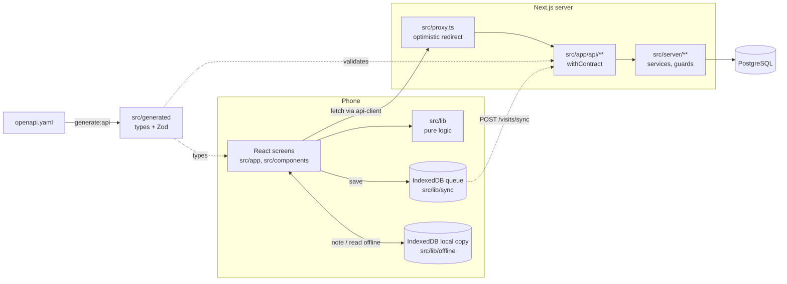

# Architecture

How the codebase is put together and why. Rules for working in it live in
[CLAUDE.md](../CLAUDE.md); the decision behind each piece lives in [tasks/](tasks/).

## Shape

One Next.js app serves both the UI and the API. PostgreSQL is the only store on the
server; on the device IndexedDB holds the visit write queue (#33) and, in a separate
database, the offline shell's local copy (#77).



## Layers

| Path                  | Holds                                                           | Coverage | Notes                                                                                 |
| --------------------- | --------------------------------------------------------------- | -------- | ------------------------------------------------------------------------------------- |
| `openapi.yaml`        | The API contract                                                | —        | Source of truth. Edited first, always.                                                |
| `src/generated/`      | Types and Zod schemas from the contract                         | excluded | Never hand-edited; CI regenerates and diffs.                                          |
| `src/app/api/**`      | Route handlers, one file per path                               | 100%     | Thin: guard, call service, return. Wrapped in `withContract`.                         |
| `src/server/http/`    | `withContract`, `ApiError`s, same-origin check, route registry  | 100%     | Validates request _and_ response; maps errors to the envelope; security headers.      |
| `src/server/auth/`    | Auth.js config, route headers, guards, rate limit               | 100%     | `requireUser`, `requireRole`, `resolveMemberScope`.                                   |
| `src/auth/`           | The Auth.js entrypoint, imported as `@/auth`                    | 100%     | Thin wrapper (D-13-5); only `session.ts` and the auth route import it (D-83-12).      |
| `src/server/<domain>` | Services, queries, serialisers per domain                       | 100%     | sessions, blocks, visits (incl. sync), follow-ups, history, users, teams, integrity.  |
| `src/db/`             | Drizzle schema, client, test env, seed data                     | 100%     | Constraints carry the invariants the API cannot race.                                 |
| `src/lib/`            | Framework-free helpers, one folder per domain                   | 100%     | Where UI logic goes so it can be tested without rendering (D-115-1).                  |
| `src/lib/sync/`       | Offline queue and sync engine                                   | 100%     | Pure functions over a `SyncQueue`; memory and `idb` adapters.                         |
| `src/lib/offline/`    | Offline shell's local copy and shell state                      | 100%     | Reducers, a `door-to-door-local` store, `shellState`.                                 |
| `src/components/`     | React components, one folder per domain; shared pieces in `ui/` | 90%      | Client components; call the API with `fetch` (D-115-1).                               |
| `src/app/**` (pages)  | Routes                                                          | 90%      | Admin pages call `requireAdminPage()` → 404 for members.                              |
| `drizzle/`            | Generated migrations                                            | excluded | From `drizzle-kit generate` only.                                                     |
| `scripts/`            | migrate, seed, create-admin, check-blank-text, generate-icons   | excluded | Glue over `src/db` and `src/server`; `check-standalone.ts` runs as npm's `postbuild`. |
| `src/app/sw.ts`       | Service worker source (Serwist)                                 | —        | Served at `/serwist/sw.js` by `src/app/serwist/[path]/route.ts`.                      |
| `e2e/`                | Playwright specs                                                | —        | Pixel 5 and iPhone 13 profiles, standalone production build.                          |
| `test/`               | Vitest setup and global setup                                   | —        | Migrates the test database and makes the run's config folder (D-109-1).               |

## Domain model

```
users ─┐
       ├─< visits >── households >── blocks
outing_sessions ─┘        │
       └─< session_blocks >┘
outing_sessions ─< session_households >── households (a follow-up session's picks)
households ─< follow_ups (optional visit_id and done_visit_id, set null on delete; status; soft delete)
outing_sessions ─< session_participants (never removed)
outing_sessions ─< session_teams ─< session_team_members (unique per session+user)
visits >── session_teams (team_id, nullable, restrict); visits ─< visit_teammates
```

- **Household** = `(block_id, unit_number)`, unique. Name, contact, religion are
  latest-known and only ever updated with non-null values; a name or contact of only
  spaces is not learnt either (D-119-7).
- A unit number, note, block name or street is never blank: the contract, the service
  (`requireText`) and a `CHECK` each refuse it (D-119-1, D-119-3, D-119-4).
  `npm run db:check-blank` lists rows stored blank before #119, and changes nothing
  (D-119-9).
- **Visit** = one knock. `interest_level` and `description` never overwritten.
  `id` is a client-generated UUIDv7 with no database default.
- **Follow-up** attaches to the household, so it outlives the session. It is `listed`
  (on the follow-up list, which only an admin decides) or `suggested` (a member's
  request, one pending per household by partial unique index). Removal is soft and
  always has a reason: the row keeps who removed it, when and why, and leaves every
  list, count and check (D-117-4, D-117-33).
  `dueDate` is a day (local midnight); overdue once that day has passed. Who may change
  a note is D-117-12; the first resolution sticks.
- **Session** (`outing_sessions`): `draft → active → ended`, reopenable. At most one
  `active`, by partial unique index, whatever its `kind`: `regular` (door-to-door) or
  `follow_up`, fixed at creation. A follow-up session has households an admin picked
  (`session_households`, at least one) and its blocks are exactly theirs, kept in step
  by `src/server/sessions/households.ts`; nobody attaches them by hand (D-117-36 to
  D-117-38). Its list is computed, never stored: picks with a listed, live note
  outstanding, or resolved since both it started and the household was picked
  (`onRevisitList`, `src/server/follow-ups/list-rule.ts`, D-117-55). In it a member
  records only at households on the list; admins are exempt (D-117-40, D-117-15). A new
  visit at a household on the list marks its owed listed notes done in the same
  transaction, and `done_visit_id` keeps which visit did (D-117-65, D-117-67). Removing a
  note never changes picks (D-117-41).
- **Blocks** are shared across members and sessions, never locked.
- **Teams** (#74) are per session. A visit is stamped once with its author's team and a
  `visit_teammates` snapshot (author excluded); names resolve at read time. Access is
  always CURRENT membership of `visits.team_id` (`src/server/teams/access.ts`,
  `canAmend`). Participants and team operations are in `src/server/teams/service.ts`
  and are online-only.

## Contested decisions

The issue-by-issue records in [tasks/](tasks/) are this project's ADRs (D-38-1). These are
the decisions that had a real alternative, summarised from those records; the record is
authoritative, and a change to any of them needs the owner.

### Households and visits, not flat visit records

- **Context.** A unit is knocked on many times, months apart, by different members. One
  flat row per knock would either repeat the person's details on every row or overwrite
  them, and would lose what an earlier visit learned.
- **Decision.** Split in two. A household is `(block_id, unit_number)`, unique, holding
  name, contact and religion as latest-known fields that are only ever updated with
  non-null values (D-07-1). A visit holds `interest_level` and `description`, which a
  later visit never overwrites (D-07-2). Follow-ups attach to the household, and
  `visit_id` is set null if the visit goes (D-07-5). Recording upserts the household by
  block and unit; the request never names a household id (D-20-1).
- **Why.** A later visit that learns nothing must not erase what an earlier one
  recorded; the interest trajectory over time is the product; losing a visit must not
  lose the promise made at the door.
- **Consequences.** Every write path has to merge identity rather than replace it
  (including teammates' amends through sync, D-74-22), and a visit can never be moved to
  another unit by an amend (D-74-32).

### JWT sessions (forced, not chosen)

- **Context.** Auth.js supports database sessions, which can be revoked on the server.
- **Decision.** JWT strategy (D-13-1). The Drizzle adapter's `auth_sessions` table
  exists only because the adapter requires it, and is unused (D-07-6).
- **Why.** The Credentials provider (email and password, #15) cannot use database
  sessions (R-2).
- **Consequences.** A token cannot be revoked and its claims are frozen at sign-in, so
  role and deactivation are read from the database on every API request and admin page;
  the token's claims are UI hints only (D-83-1, D-83-3). Deactivation is a
  `403 account_deactivated` on any operation (D-10-4, D-83-4).

### One active session app-wide

- **Context.** Admins run sessions; members record into whichever is running.
- **Decision.** At most one `outing_sessions` row has `status = 'active'`, of either
  kind, enforced by a partial unique index (D-07-4). A second start is
  `409 session_already_active`, decided by the database with no pre-check (D-17-2).
- **Why.** Two concurrent starts are a race the API cannot close on its own.
- **Consequences.** Members never choose a session, only a block in the running one.
  Queued visits for an ended session are held, not dropped, until it is reopened
  (D-21-4). The E2E suite runs on one worker because parallel specs would fight over the
  one active session (D-37-4).

### Admins decide the follow-up list

- **Context.** Any member could write, resolve and reopen a note at any time (D-35-1),
  so the list of doors to revisit was whatever anyone had written.
- **Decision (owner).** Only an admin puts a household on the list; a member's note is a
  suggestion an admin adds or dismisses. A follow-up session goes back to households an
  admin picks from that list, at least one, and its blocks follow them. Members change
  listed notes only during a follow-up session that picked them, and record only at its
  picks. Every removal is soft and needs a reason (D-117-3, D-117-4, D-117-12, D-117-15,
  D-117-33, D-117-36 to D-117-38).
- **Why.** A follow-up session needs a list someone chose, a member must never open an
  empty block, and a removal must be explainable to the note's author.
- **Consequences.** One rule decides the list, the recording refusal and a member's
  right to change a note, so they cannot disagree (D-117-40). An offline record for a
  unit off the list is held until an admin lists and picks it (D-117-16). Picks and
  visit writes meet on the session row in one lock order (D-117-45). A visit at a door on
  the list closes its notes on the server, so a queued one does too when it lands
  (D-117-73). Removed notes stay in the database for good.

### Serwist, not next-pwa

- **Context.** The app needs a service worker for installability and an offline
  fallback.
- **Decision.** Serwist (D-32-1), now through `@serwist/turbopack`, with the worker built
  by a route handler at `/serwist/sw.js` (D-32-2, superseding D-32-1's `@serwist/next`).
- **Why.** `next-pwa` is unmaintained and Serwist is its maintained successor, the option
  the Next.js PWA guide points to (R-1). `@serwist/next` is a webpack plugin, and Next 16
  builds with Turbopack by default (R-17).
- **Consequences.** The worker is disabled outside production builds and updates are
  prompted, never forced (D-32-6, D-32-14); what it may cache is deliberately narrow
  (D-32-3, D-32-4).

## Request path

1. `src/proxy.ts` redirects page requests with no session to `/sign-in` and returns
   `401` for API requests. Node runtime (Next 16), so it can read the config file; it uses `buildBaseAuthConfig` (`src/server/auth/base-config.ts`, no adapter).
   It is an affordance, not a guard. The PWA files (`/serwist/*`, manifest, `/offline`)
   return before `auth()` runs (D-32-19). On every path it matches (all but static
   files), Next buffers at most 2 MB of the body and hands the handler that much: a
   longer body is cut short, not refused (`experimental.proxyClientMaxBodySize`,
   D-120-7).
2. The route handler is wrapped in `withContract(operation, handler)`. First, a write
   (not `GET`, `HEAD` or `OPTIONS`) another origin sent is `403 forbidden`: decided by
   `Sec-Fetch-Site`, else by `Origin` against `X-Forwarded-Host` or `Host`
   (`src/server/http/same-origin.ts`, D-121-1 to D-121-5). Then path, query
   (schema-driven coercion) and body are parsed with generated Zod; a body that is not
   `application/json` is `415` (D-121-6); PATCH bodies go through `requireChanges`.
   This runs before any role check. Every request array but
   `CreateTeamRequest.memberIds` has a `maxItems`, so an oversized one is refused on its
   length before any item is parsed (D-118-5, R-91). `memberIds` is uncapped (D-74-15,
   D-118-6); only step 1's 2 MB cut bounds it, and an explicit refusal of a large body is
   #126.
3. The handler gets its session from `currentSession` (`src/server/auth/session.ts`),
   which reads the user's role and deactivation from the database on every request (one
   primary-key lookup, no cache), then calls the pure `requireUser` / `requireRole`.
   Missing user is `401`, deactivated `403 account_deactivated`. A lookup failure is a
   `500`, never allowed.
4. The service does the work. Text that must say something (a unit number, note, block
   name or street) is refused blank before anything is read (D-119-3). Sync and
   `POST /visits` also run the clock rules
   (`src/server/visits/clock-rules.ts`) before any write. Inside the write's
   transaction they lock the session row (`FOR KEY SHARE`) and judge the session, the
   block and, in a follow-up session, the list rule for a member's new visit
   (`assertMayRecordHere`, refused `409 not_on_follow_up_list`); a new visit on the list
   then marks the household's owed notes done, last (`markDoneByVisit`, D-117-69), and
   the answer is a `RecordedVisit` naming them. An amend (`PATCH /visits/{id}`, or a
   sync item for a stored visit) is one transaction that locks the session
   `FOR KEY SHARE`, the household, the visit `FOR NO KEY UPDATE` and the team membership
   `FOR KEY SHARE`, and judges `canAmend` on those rows (D-123-1 to D-123-3). Changing a
   follow-up session's households, detaching a block and transitions lock that row
   `FOR UPDATE` (D-117-45, D-123-4).
   Constraint violations are recognised by name through
   the cause chain (`isConstraintViolation`) and turned into specific `409`s.
5. `withContract` parses the response; anything not in the contract fails in dev/test
   and is a logged `500` in production. Only the parsed value is sent.

An unexpected error (not an `ApiError`) becomes a generic `500 internal_error`.
`withContract` logs it as one line, `<operationId> failed: <summary>`, built by
`summarizeError` (`src/server/logging/error-log.ts`): name, code and a redacted first
line, never the cause chain or parameters. The first line ends at any line break, and
control characters are replaced (D-128-7). The log is throttled to one line per operation
per 5 s burst. The sync catch uses the same helpers.

## Response headers

- `next.config.ts` `headers()` applies one build-time list
  (`src/server/http/security-headers.ts`) to `/(.*)`. It holds a Report-Only CSP, HSTS
  `max-age=63072000` without `includeSubDomains`, `nosniff`,
  `Referrer-Policy: same-origin`, `Permissions-Policy` and `X-Frame-Options: DENY`.
  `X-Powered-By` is off (D-122-1 to D-122-6). Enforcing the CSP means changing the
  `CSP_HEADER` constant, which waits for the first deployment (D-122-14, #146). Client
  zod runs jitless (`src/instrumentation-client.ts`), so its eval probe does not trip
  the policy (D-122-7).
- API answers are `Cache-Control: no-store`, set in three places: `jsonResponse` in
  `withContract`, the `401` the proxy writes, and `withAuthRouteHeaders`
  (`src/server/auth/route-headers.ts`) around Auth.js's route. A sign-out `POST` also
  gets `Clear-Site-Data: "cache"` there (D-122-9, D-122-10). Next's own bodiless
  `405`, `OPTIONS` and trailing-slash `308` answers are the exceptions.
- The proxy marks `no-store` on every response that carries `Set-Cookie`, once Auth.js
  has added its cookies. It always marks `/sign-in`, which Next would otherwise send as a
  prerender with `s-maxage=31536000` (D-150-1, D-150-2). `/offline` still sends that
  `s-maxage`, and sets no cookie (#146).

## Configuration

- Settings are a YAML file read at runtime (`CONFIG_PATH`, default `./config.yaml`).
  `config.example.yaml` and `config.docker.yaml` are committed; `config.yaml` is not.
  Pure parsing and validation is `src/lib/config.ts`; file access and caching is
  `src/server/config.ts`.
- Secrets never go in the file: database user/password, `AUTH_SECRET`,
  `AUTH_GOOGLE_SECRET` are env vars with optional `_FILE` variants. `database.url` with
  credentials is refused.
- Loading is lazy (config, rate limiter, proxy, db client), so `next build` needs neither
  file nor database. `src/instrumentation.ts` validates at start and exits 1 on bad config.
- Tests use `TEST_DATABASE_URL`, the one place a full URL is allowed.

## Auth

Auth.js v5, JWT strategy (forced: the Credentials provider cannot use database
sessions). The token carries identity; its role and deactivation claims are UI hints and
are never used for authorization, which reads the database per request (also for admin
pages, with `admin/layout.tsx` as a structural guard). Credentials use argon2id
(`@node-rs/argon2`) with a decoy hash for unknown emails. An email or password longer
than any account can hold is refused before anything else (D-120-1). Failed attempts are
then counted in up to three in-memory budgets, charged in this order: app-wide (an
incident switch, off unless `rateLimit.signInAttemptsGlobal` is set), per client (only
when `rateLimit.trustedProxyHops` is at least 1), and per email. A spent budget refuses
even the right password. A success clears the email's count, but gives back only its own
attempt on the shared budgets (D-120-5, D-120-6, D-120-11). Limiter keys are HMAC
digests, and a limiter holds only live windows, at most 100,000 of them (D-120-2 to
D-120-4). The pieces are `rate-limit.ts`, `client-address.ts` and `sign-in-log.ts` in
`src/server/auth/`.
Auth.js logs through `auth-log.ts`, which `buildBaseAuthConfig` sets, so the proxy's
instance and the route's use the same logger. An error is one line: its type and the
wrapped cause's code, never a message, stack or cause property. A warning is its code,
and debug output is dropped. Lines are throttled for 60 s, and the throttles sit on a
`Symbol.for` global that both module graphs share. A failed sign-in is left to
`sign-in-log.ts`, which also logs a credentials check that throws (D-128-1 to D-128-7).
The first admin of a fresh database comes from `npm run create-admin`, which refuses once
any admin exists (D-105-3).
Google SSO (#14) is not built; it will live in `src/auth/` beside the entrypoint
(D-115-3).

The cookies are `Secure`, with the `__Secure-` and `__Host-` prefixes, whatever scheme
the server sees, because `auth.secureCookies` (default `true`) is passed to
`buildBaseAuthConfig` as `useSecureCookies`. The route handlers and the proxy therefore
look for the same names. Only the plain-http runs, E2E and Compose, turn it off
(D-122-12).

## Client

- Screens fetch through `src/lib/api-client.ts`, typed by `types.gen.ts`.
- The session reaches the app through `DeferredSessionProvider`
  (`src/components/shell/`, in the root layout). Auth.js's `SessionProvider` sits beside
  the app, and a relay hands its value on in a transition, so a screen whose own script
  is late keeps its server HTML. Until that screen is live, the shell reads `loading`
  (D-113-7).
- `useRole()` is UI affordance only. Its role comes from the latest `GET /users/me`
  (`loadCurrentUser()`) when that matches the token's user, else from the token.
- `apiFetch` reports any `401` or `403 account_deactivated` to `src/lib/session/account-state.ts`
  and still throws. `AccountGate` (in `AppShell`) then shows `AuthFailureScreen`, a
  blocking `useModal` (`onClose: null`) that makes the app `inert`; its only action signs out. The gate also reads `/users/me` once
  per document load.
- Overlay layers: sync status bar `z-20` (sticky while something is unsent), banners
  `z-30`, bottom nav `z-40`, sheets `z-50`, confirm and Not saved dialogs `z-60`, account
  screen `z-70`.
  Guarded by `src/components/overlay-layers.test.ts`, which walks every component folder
  and reads the sheet and dialog layers from `src/components/ui/sheet.tsx`.
- Every sheet and `ConfirmDialog` is built on `Sheet`, both in `src/components/ui/sheet.tsx`,
  portalled to `<body>` and made modal by `useModal` (`src/lib/hooks/use-modal.ts`). Focus moves
  in, Tab is trapped, Escape closes the top layer only, the page behind is `inert` and
  unscrollable, and focus goes back to the trigger, or to the sheet's `returnFocus`
  (D-90-2 to D-90-9, D-119-15). A blocking modal
  stays on top of the stack, and siblings mounted later go inert too (D-85-12, D-85-14).
  The account message calls `useModal` directly.
- A Save of a visit or a note that is refused for a blank unit number or note, or
  answered `400 validation_failed`, opens `NotSavedDialog`
  (`src/components/ui/not-saved-dialog.tsx`), which lists every reason. The reasons are
  built by `src/lib/not-saved.ts`, which matches the server's `details` (kept on
  `ApiRequestError`) to the form's fields. Field errors and the line beside Save stay
  (D-119-13 to D-119-19).
- Inside `SheetPresence`, a sheet rises and leaves on a Motion spring and drags down to
  dismiss, its scrim following it. The physics is in `src/lib/session/sheet-motion.ts`.
  `useModal` gives back focus, the page and scrolling as the exit starts (D-111-13 to
  D-111-18, D-111-41). A sheet given `discard` holds typed work: a pull resists, and a
  dismissing pull or a backdrop tap asks first (D-111-42).
- Motion (`motion`, pinned) is imported only by `sheet.tsx`, through `LazyMotion`. The
  root layout reaches no sheet statically: the sync sheet is fetched when the page is
  idle (`src/components/sync/sync-queue-loader.ts`, `src/lib/hooks/when-idle.ts`). `src/app/first-load.test.ts`
  checks this (D-111-15).
- Styling is Tailwind v4 `@theme` and `@utility` in `src/app/globals.css`, with no
  one-off colours or blur (D-111-5):
  - Colour tokens (`--app-*`) in light and dark, with stronger edges and text under
    `prefers-contrast: more`.
  - `--reader-rem`, the text size: 16 to 32px, following iOS Dynamic Type. Spacing and
    the type scale are multiples of it.
  - `chrome-size` holds the nav, the docked Save bar and the sync row at the 16px base
    (`--chrome-rem`) at every text size; `--nav-height` is 64px. `bleed-x` lines them up
    with the page's margin (`--page-gutter`), and `scroll-clear-chrome` scrolls clear of
    them.
  - Control utilities: `btn-*`, `field`, `notice-*`.
  - Press feedback: `press`, `press-row` and the base layer. `PressFeedback` in
    `AppShell` makes iOS honour `:active`. No `filter` is ever transitioned
    (`src/app/filter-transitions.test.ts`).
  - `material-chrome`, the grainy glass, solid under reduced transparency or more
    contrast.
  - `scroll-edge`.
  - The short-screen switch: `--short-by`, read through `clamp()` by `control-compact`
    and `space-under-tabs`, so it holds on the first paint.

  See D-111-10, D-111-11, D-111-19, D-111-22, D-111-24, D-111-48, D-111-60 and
  D-111-67.

- A page's primary action is `DockedActions`, pinned above the nav and glass while
  pinned. `DockHost` holds it at the end of the block screen and the offline shell, and
  draws a `standIn` there until it mounts, so Save is in the server's HTML (D-111-20,
  D-111-40). A tap on the stand-in saves nothing. The unit and the level typed into the
  server's HTML are adopted as the form mounts (`useEarlyInput`), and until then
  `useLive` keeps Enter from submitting the form natively (D-113-1 to D-113-5). Unit
  numbers are shown through `UnitNumber`, which never splits them (D-111-36).
- Child screens pass `back` to `PageHeader`: a link, or an in-page action (`BackButton`,
  the offline shell's way back to its blocks). A retracing `BackLink` uses
  `src/lib/session/screen-trail.ts`, fed by `ScreenTrailKeeper` in `AppShell` (D-111-28).
  Every date goes through `src/lib/history/dates.ts` (D-111-29).
- The bottom nav does not render on public routes (its prefetches poisoned the
  router cache before sign-in) nor on the offline shell.
- Active-session screen: "Join this session" (shown until the caller is in the server's
  participants list) and a "Your team" card (`outing-team.tsx`, `team-sheet.tsx`, texts in
  `src/lib/teams/team-ui.ts`). Online-only: controls disable offline and nothing is queued or
  stored. The card refreshes with the screen's 30s poll and Refresh.
- Records show who made them through `VisitByline` (`src/lib/teams/team-label.ts`): the author
  then the snapshot teammates with current names, plus a "Team:" chip (not on unit rows).
  Display-only; Amend affordance uses team ids the server vouched for
  (`GET /sessions/{id}/teams` or `includeTeam` results), see `src/lib/history/amend.ts`.
- Follow-ups: bylines and the timeline in `src/lib/history/follow-ups.ts`; rights, the
  list and hints in `src/lib/follow-ups/`. `HouseholdHistoryPanel` (unit screen and
  recording form) pins "On the follow-up list" and "Waiting for review" above a
  visits-and-resolved-notes timeline. Controls come only from `followUpRights`, which
  mirrors the server (D-117-25). `/follow-ups` has On the list, Waiting for review
  (`?view=review`) and Mine (`?view=mine`). Admins review at `/admin/follow-ups`
  (`?tab=`), and `/admin/sessions` carries the review count and overdue cards.
  Removals go through one reason sheet (`src/lib/follow-ups/removal.ts`); listing a door
  offers "Also add to {session}" (`target-session.ts`, `add-to-list.ts`, D-117-46).
  Online-only, re-read from the server after each change; only a queued visit's own
  marking happens later, on the server (D-117-73).
- Follow-up session: created with households picked from the follow-up list
  (`household-picker.tsx`, `src/lib/follow-ups/pick.ts`); its admin page lists the picks
  (`GET /sessions/{id}/households`, `session-households.tsx`) with read-only blocks. The
  member's session screen is "Households to revisit" (`GET /sessions/{id}/revisits`,
  re-read on its 30s poll); the block screen shows listed units as chips and reads the
  list again before refusing a unit, and a block outside the running session offers no
  form. After a save there, the Saved line and Record for a member say what was marked
  done and offer Undo (`src/lib/follow-ups/marked-done.ts`, `UndoMarkedButton`,
  D-117-71, D-117-76). First-use hints and the removal notice are remembered in
  `localStorage`, per phone (D-117-29).
- `/history` and `/history/[id]` have a Me / My team toggle held in `?view=team`
  (`src/lib/teams/team-view.ts`); the team view reads `/history/mine?includeTeam=true`.
- The admin session detail has a team panel (`admin-teams.tsx`, `admin-team-sheet.tsx`),
  online-only and re-read on the detail screen's 30s poll.
- User pickers load every page of `GET /users` through `loadAllUsers()` (`src/lib/session/users.ts`).
- Whole follow-up lists (the removal notice, the household picker, Add households, On the
  list) load every page through `loadAllFollowUps()` (`src/lib/follow-ups/pages.ts`),
  keeping each note once by id (D-117-52).
- Native selects carry `h-12`: iOS WebKit ignores `min-height` on a select.
- Account screen (`/account`): reads the name from `GET /users/me`, renames through
  `PATCH /users/me`, then calls the JWT `update` trigger, which accepts only a valid
  display name. The token name is display-only; handlers read the database.
- Sign-out (`src/lib/session/sign-out.ts`): clears the block cache and the local copy (never the queue), warns
  on the member's unsent records (`hasUnsyncedItems(ownerId)`, D-33-15),
  `signOut({ redirect: false })`, then a full navigation to `/sign-in` (or a given
  destination, e.g. `/sign-in?reason=signed-out`). A refusal
  (Auth.js returns an `error` URL with 200) throws instead, and Account shows "Could not
  sign out".
- The proxy sets `Cache-Control: no-store` on signed-in page responses and `/sign-in`,
  so Back after sign-out revalidates instead of restoring the page from bfcache. API
  answers get theirs from their handlers, and also from the proxy when they carry a
  cookie (see Response headers). The sign-out `POST`'s `Clear-Site-Data: "cache"` never
  touches Cache Storage or IndexedDB.

## PWA and service worker

- `src/app/manifest.ts` and icons (`npm run icons` from `public/icon.svg`) make the
  app installable. The worker (`src/app/sw.ts`, `@serwist/turbopack`) is served at
  `/serwist/sw.js` and is disabled outside production builds. Manifest, `/serwist/*`
  and `/offline` are public to the proxy, which returns before `auth()` for them so a
  cookieless fetch never mints a CSRF cookie (D-32-19).
- Precache: static assets, icons and `/offline`; never authenticated HTML.
  Navigations are network-only with an `/offline` fallback. API is network-only except
  `GET /api/blocks` (stale-while-revalidate, own cache, 24h / 20 entries).
- The worker never touches IndexedDB. Updates are prompted and defer while the
  signed-in member's records are queued or failed (`hasRecordsToSend`, D-33-14); a
  page is controlled from its second load.
- `PwaProvider` registers the worker; `InstallPrompt` and `UpdatePrompt` render inside
  `main`. `UpdatePrompt` is a fixed banner at `z-30` that reserves `--banner-top`.
  `InstallPrompt` floats the same way above the nav, reserving `--banner-bottom`, only
  while it is at most a quarter of the screen and no docked Save is on screen; otherwise
  it is a card at the end of the page (D-111-46).
- Sign-in and sign-out clear the cached block list (sign-out: D-74-9) and the local
  copy (D-77-6). The block-list clear gives up after 1.5 s and never blocks either
  (D-111-68).

## Offline

`POST /visits/sync` is idempotent on the client id, resolves conflicts last-write-wins
on `updatedAt`, reports per item (`applied`, `unchanged`, `stale`, rejected), and is rate
limited. Clock rules (#76) apply to it and to `POST /visits`: a batch whose `sentAt` is
off from the server by more than `sync.clockSkewToleranceSeconds` is refused `422
clock_skew`; items stamped in the future or before their session are rejected
`clock_skew` while siblings apply.

**Queue (#33).** The recording form writes the visit to IndexedDB (`door-to-door`,
store `visits`, index `by-owner`) and moves on; it posts directly only when the queue
cannot be written. A visit is queued only with its session's id (D-33-25). Each record carries its owner and a state: `queued`, `failed`,
`held`, `quarantined` or `synced`. Sending is in memory only. Nothing unsent is ever
deleted; sent records are purged after 24 h.

```
save ─► IndexedDB ─► controller (trigger) ─► Web Lock ─► GET /api/auth/session
                                                    │   (owner still signed in?)
                                                    ▼
                    flushOnce: owner's due records, oldest first, ≤100 (1 if isolated)
                                                    ▼
                    POST /visits/sync via apiFetch (fresh sentAt, 20 s timeout)
                                                    ▼
                    classify per item / whole batch ─► write back ─► BroadcastChannel
```

- `src/lib/sync/`: `enqueue` builds the item, `engine` sends a run, `classify` decides
  each outcome, `backoff` times retries, `controller` owns triggers, the lock and the
  timer. `idb-queue` and `memory-queue` implement `SyncQueue`; `record` validates every
  read, salvaging a record whose knock and owner are intact (D-34-8). `signed-in`
  checks the cookie's member before each batch. After a run storage fails, the
  controller waits 5 s doubling to 5 min before its timer fires again (D-34-6).
- Triggers: app start, each save, `online`, focus and visibility, the backoff timer,
  Retry. No Background Sync.
- `SyncProvider` (in `AppShell`) runs one controller for the signed-in member.
  `SyncStatusBar` (pinned only while something is unsent) and `SyncQueueSheet` (a chunk
  of its own, fetched when the page is idle) show it and retry it. The unit list overlays
  unsent records (`unit-overlay.ts`).
- Outcomes are D-33-16 (per item) and D-33-17 (whole batch); the cap and isolation are
  D-33-26, D-33-6 and D-33-27 (a whole-request failure is never charged to a record).

**Offline shell (#77).** A navigation that fails gets the precached, static `/offline`
at the address that failed; `OfflineShell` then reads the local copy at runtime.

```
online:  session / block screen ─► useLocalCopyWriter ─► door-to-door-local (copy)
offline: SW fallback /offline ─► OfflineShell ─► loadLocalCopy, usableCopy (≤ 12 h)
           ─► "Continue as <name>" ─► shellState.continueAs ─► SyncProvider owner
           ─► BlockViews (in-page, not amendable) ─► queue as usual
```

- The copy (`src/lib/offline/`, `v: 2`) holds the member, the session, each opened
  block's `HouseholdSummary[]` and a follow-up session's list, validated with the
  generated Zod on read (D-77-3, D-117-17). The shell reads the list again once the
  server answers. A follow-up session's list alone makes the copy usable: the shell's
  home is then the list, and a block never opened is built from it with only its listed
  households (`shellList`, `shellBlocks`). After "Continue as" the shell opens the block
  and unit the failed address named (`shell-target.ts`, D-117-48). The copy is cleared
  on sign-in, sign-out and by `LocalCopyKeeper` on a member mismatch; never the queue
  (D-77-2, D-77-6).
- While the shell is shown, `shellState` (not the path or session) decides the queue
  owner, the sync bar and the hidden nav (D-77-10, D-77-12). The chrome reads the route
  through `useRoutePathname`, which is `/offline` there on server and client alike,
  never the failed address (D-117-63). Sends still go through
  `sendAs`, so the cookie must name the owner.
- The queue flushes on its own triggers; a reconnect row offers Continue (a full
  `goTo`) once the server answers (D-77-11). `ReloadWhenOnline` runs from the first render
  until "Continue as": while the copy loads, when there is none, and at the gate
  (D-106-8).

**Sync write path.** Each item runs in one transaction. It first locks its session's
row `FOR KEY SHARE` and judges, under that lock, that the session is still active, the
block is in it and, for a member's new visit in a follow-up session, the unit is on its
list (D-117-45). Then `INSERT ... ON CONFLICT DO
NOTHING RETURNING` (a row back means newly created, the only trigger for the teammate
snapshot, auto-join and, in a follow-up session, marking the household's notes done),
otherwise `SELECT ... FOR NO KEY UPDATE` (D-123-2), re-judge under the lock
(`canAmend`, newer `updatedAt`, same household and session), then a narrow `UPDATE` of
interest, description and `updatedAt`. Non-`ApiError` failures are `rejected` with
`internal_error` (retryable). The request path above is unchanged; the new endpoints
(`/sessions/{id}/join`, `/participants`, `/teams`, `/teams/{id}/members`) are ordinary
`withContract` handlers.

**Limit: pairs and the queue.** The queue lives in one phone's IndexedDB, scoped to the
member who saved each record (D-33-1). Teammates (#74)
see and edit each other's records only once they have synced; unsynced records are
visible on the phone that made them and nowhere else, because two phones with no
reception cannot exchange data. The sync endpoint's rule that a member cannot overwrite
another member's visit (D-21-5) has a team exception (D-74-22), not a way around the queue.

## Testing

| Layer       | Tool                             | Runs against                                                           |
| ----------- | -------------------------------- | ---------------------------------------------------------------------- |
| unit        | Vitest (`*.test.ts`)             | node                                                                   |
| integration | Vitest (`*.integration.test.ts`) | real PostgreSQL (`db-test`, 5433)                                      |
| components  | Vitest (`*.test.tsx`)            | jsdom + Testing Library                                                |
| e2e         | Playwright (`e2e/`)              | standalone production build, Pixel 5 (Chromium) and iPhone 13 (WebKit) |

The E2E browser runs at UTC+14 and its server at UTC−12, and every page a fixture hands
out fails its test on a hydration mismatch, attributes included (D-117-64), or on any
CSP violation (D-122-8).

## Runtime

- **Dev:** `docker compose up` → `db`, one-shot `migrate` (migrate + seed), `web`.
- **Prod:** multi-stage `Dockerfile`, `output: "standalone"`, served by
  `node .next/standalone/server.js`.
  The output never holds `config.yaml` or a `.env`: `postbuild` deletes the `.env` Next
  copies and fails the build on anything else (D-106-2, D-106-3). Settings and secrets
  arrive at runtime. The image optimizer is off, so `/_next/image` is a `404` (D-118-4).
- **Database pool:** one `pg` pool per process, cached on a `Symbol.for` global so
  Next's separate module graphs share it; changing `database.url` needs a restart. Every
  pool (app, scripts, test helper, E2E setup) gets `attachPoolErrorHandler`
  (`src/db/pool-errors.ts`). A dropped connection is logged once per burst and replaced
  on the next query. The query in flight rejects, so the request is a `500` and never
  crashes the process.
- **CI:** static checks (lint, types, format, spec lint, codegen and migration drift),
  tests with coverage against Postgres, production build, E2E. Dependabot
  (`.github/dependabot.yml`) opens grouped npm and Actions updates weekly (D-118-7).
