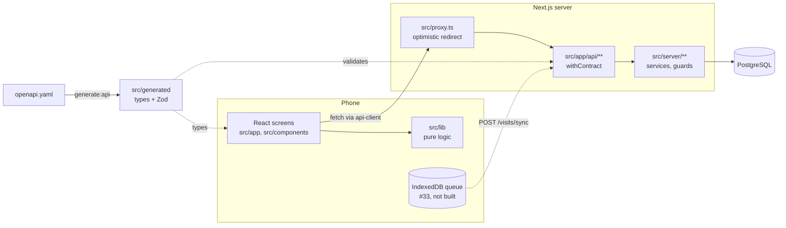

# Architecture

How the codebase is put together and why. Rules for working in it live in
[CLAUDE.md](../CLAUDE.md); the decision behind each piece lives in [tasks/](tasks/).

## Shape

One Next.js app serves both the UI and the API. PostgreSQL is the only store on the
server; IndexedDB will be the store on the device once the offline queue lands (#33).



## Layers

| Path                  | Holds                                       | Coverage | Notes                                                              |
| --------------------- | ------------------------------------------- | -------- | ------------------------------------------------------------------ |
| `openapi.yaml`        | The API contract                            | —        | Source of truth. Edited first, always.                             |
| `src/generated/`      | Types and Zod schemas from the contract     | excluded | Never hand-edited; CI regenerates and diffs.                       |
| `src/app/api/**`      | Route handlers, one file per path           | 100%     | Thin: guard, call service, return. Wrapped in `withContract`.      |
| `src/server/http/`    | `withContract`, `ApiError`s, route registry | 100%     | Validates request _and_ response; maps errors to the envelope.     |
| `src/server/auth/`    | Auth.js config, guards, rate limit          | 100%     | `requireUser`, `requireRole`, `resolveMemberScope`.                |
| `src/server/<domain>` | Services, queries, serialisers per domain   | 100%     | sessions, blocks, visits (incl. sync), follow-ups, history, users. |
| `src/db/`             | Drizzle schema, client, env, seed data      | 100%     | Constraints carry the invariants the API cannot race.              |
| `src/lib/`            | Framework-free helpers                      | 100%     | Where UI logic goes so it can be tested without rendering.         |
| `src/components/`     | React components                            | 90%      | Client components; call the API with `fetch`.                      |
| `src/app/**` (pages)  | Routes                                      | 90%      | Admin pages call `requireAdminPage()` → 404 for members.           |
| `drizzle/`            | Generated migrations                        | excluded | From `drizzle-kit generate` only.                                  |
| `scripts/`            | `migrate.ts`, `seed.ts` entrypoints         | excluded | Glue; the logic they call is in `src/db`.                          |
| `e2e/`                | Playwright smoke flows                      | —        | Three flows, phone viewport, production build.                     |

## Domain model

```
users ─┐
       ├─< visits >── households >── blocks
outing_sessions ─┘        │
       └─< session_blocks >┘
households ─< follow_ups (optional visit_id, set null on delete)
```

- **Household** = `(block_id, unit_number)`, unique. Name, contact, religion are
  latest-known and only ever updated with non-null values.
- **Visit** = one knock. `interest_level` and `description` never overwritten.
  `id` is a client-generated UUIDv7 with no database default.
- **Follow-up** attaches to the household, so it outlives the session.
- **Session** (`outing_sessions`): `draft → active → ended`, reopenable. At most one
  `active`, by partial unique index.
- **Blocks** are shared across members and sessions, never locked.

## Request path

1. `src/proxy.ts` redirects page requests with no session to `/sign-in` and returns
   `401` for API requests. Edge runtime, so it uses `baseAuthConfig` (no adapter).
   It is an affordance, not a guard.
2. The route handler is wrapped in `withContract(operation, handler)`: path, query
   (schema-driven coercion) and body are parsed with generated Zod; PATCH bodies go
   through `requireChanges`.
3. The handler calls `requireUser` / `requireRole`. Deactivation is re-checked here on
   every request because sessions are JWTs.
4. The service does the work. Constraint violations are recognised by name through
   the cause chain (`isConstraintViolation`) and turned into specific `409`s.
5. `withContract` parses the response; anything not in the contract fails in dev/test
   and is a logged `500` in production. Only the parsed value is sent.

## Auth

Auth.js v5, JWT strategy (forced: the Credentials provider cannot use database
sessions). Role and deactivation travel on the token. Credentials use argon2id
(`@node-rs/argon2`) with a decoy hash for unknown emails and a per-email rate limit.
Google SSO (#14) is not built.

## Client

- Screens fetch through `src/lib/api-client.ts`, typed by `types.gen.ts`.
- `useRole()` is UI affordance only.
- Overlay layers: bottom nav `z-40`, sheets `z-50`, confirm dialogs `z-60`. Guarded
  by `overlay-layers.test.ts`.
- The bottom nav does not render on public routes (its prefetches poisoned the
  router cache before sign-in).

## Offline (planned)

Server side is done: `POST /visits/sync` is idempotent on the client id, resolves
conflicts last-write-wins on `updatedAt`, reports per item (`applied`, `unchanged`,
`stale`, rejected), and is rate limited. Client side — IndexedDB queue, sync engine,
service worker — is #32–#34.

## Testing

| Layer       | Tool                             | Runs against                         |
| ----------- | -------------------------------- | ------------------------------------ |
| unit        | Vitest (`*.test.ts`)             | node                                 |
| integration | Vitest (`*.integration.test.ts`) | real PostgreSQL (`db-test`, 5433)    |
| components  | Vitest (`*.test.tsx`)            | jsdom + Testing Library              |
| e2e         | Playwright (`e2e/`)              | standalone production build, Pixel 5 |

## Runtime

- **Dev:** `docker compose up` → `db`, one-shot `migrate` (migrate + seed), `web`.
- **Prod:** multi-stage `Dockerfile`, `output: "standalone"`, served by
  `node .next/standalone/server.js`.
- **CI:** static checks (lint, types, format, spec lint, codegen and migration drift),
  tests with coverage against Postgres, production build, E2E.
